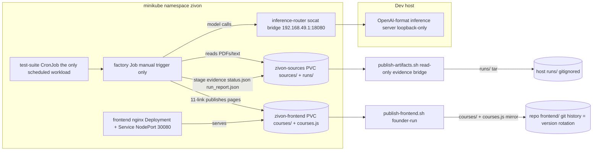
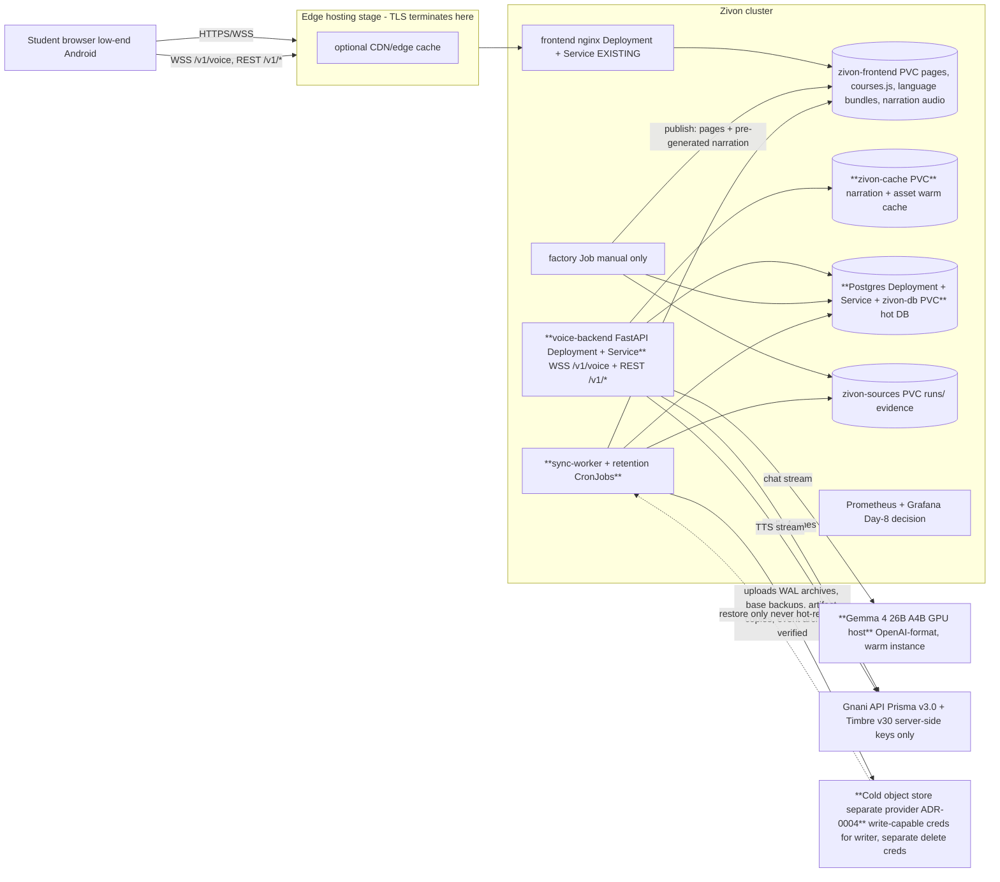

# Backend specification — Zivon

Stage-2 systems design (2026-11-07). Consumes `docs/product/backend-handoff.md` +
`features.md` + inventories; does not re-derive them. Gate D is frozen: the P0 slice below
is exactly the signed-off 16-P0 ladder's backend needs — nothing more. Every endpoint,
message, and table cites a Stage-1 ID (`NEED-`/`INF-`/`ENT?-`/`EVT-`) or is labelled
*systems-originated* with a reason. All numbers `[ASSUMPTION]` until measured.

---

## 1. Scope, decisions inherited, and the assumptions register

### 1.1 Inherited decisions (binding, not re-litigated)

- Voice stack: **Prisma v3.0** STT (`indic-auto`, `detected_language_code`) + **Timbre v3.0**
  TTS (13 polyglot voices, 13 expressive tags, tags billable as characters) — verified facts
  in `docs/DECISIONS-and-RESEARCH/02-all-about-gnani.md` addendum 12. Runtime LLM:
  **Gemma 4 26B A4B**, self-hosted, OpenAI-format serving via the existing
  inference-router pattern (Gate A outcome). Evon v3.3 is post-challenge aspiration — not
  designed against.
- Architecture: hybrid B+ — static curated content (Core) + on-demand page-anchored doubt
  tutor. Layer independence: Core (read/simulate/check) stays up when voice, TTS,
  translation runtime, or personalization is down.
- Infra: Docker + Kubernetes + GitHub Actions + GHCR; voice backend = Deployment + Service;
  factory = manual-trigger Job; frontend = nginx Deployment over `zivon-frontend` PVC;
  TLS terminates at the edge only; secrets runtime-only; CI key-free; `k8s/infra.env` is
  the config-values source of truth.
- Identity: no accounts, no auth for students (TIMELINE out-of-scope). Anonymous
  device-scoped pseudonymity with a nullable `guardian_ref` seam (T6). Consent gates the
  ADD layer only (voice input, transcripts, coverage server sync).
- **Founder corrections 2026-11-07 (Stage-2 session, recorded in Stage-1 docs):**
  1. Credit guard = **1,000 credits/day global tranche** + **30 credits/user/day**
     (free-trial scale; the earlier 200 default was a misunderstanding) + togglable
     `normal` ↔ `demo` profiles (demo = relaxed but bounded; exact numbers are a founder
     calibration item). **Credits meter only the voice agent** (Prisma STT + tutor Timbre
     TTS).
  2. Course-material narration is **pre-generated at build time and stored** (DB asset row
     + audio object), served statically — C-051 adopted; zero runtime TTS calls for
     read-aloud; no per-student credit burn.
  3. Everything except the voice agent is accessible **without login**; abuse/DDoS
     prevention is by **IP-keyed rate limiting** (hashed IP, short retention), applied
     especially to static audio/TTS assets and the realtime channel.
  4. Storage is **three distinct units**: backend cache (fast, small) · hot DB (Postgres,
     hosted alongside the backend) · cold storage (separate provider) — see §2 glossary and
     `storage-tiering.md`.

### 1.2 Assumptions register (Phase-1 validation output — gaps made explicit)

Phase-1 validation result: **all 18 NEEDs have a caller; all 105 INF rows have a source;
all 18 EVT events have an emitter** (verified mechanically against the inventories; see
§16 traceability). No requirement is silently dropped. The following gaps are carried as
explicit assumptions, each with an owner and a calibration trigger:

| # | Assumption | Value used | Owner / calibration trigger |
|---|---|---|---|
| A-01 | Gnani credit unit prices (credits per STT second, per TTS character) are not published in the repo | capacity model is parameterized; reconciliation table in `capacity-and-cost.md` | founder — read the Gnani dashboard before Gate-C rehearsal (already an ops action in features.md §7.3) |
| A-02 | "Transcripts: server log TTL 7 d" is implemented as **DB rows with a 7-day hard-delete TTL** (`voice_turn`), not log files; structured logs carry no transcripts (single system of record, enforceable deletion path) | 7 d hard delete | Stage-2 interpretation, recorded here; revisit if debugging proves insufficient (T11 falsification test) |
| A-03 | Per-user cap keyed on the client-generated `device_pseudo_id` is spoofable; it is abuse friction + budget hygiene, not identity (consistent with T6) | device_pseudo_id keying | accepted for demo; VPC design is a counsel item (C-087) |
| A-04 | Hinglish is a UI locale value (`hinglish`) beyond the 10 Gnani codes; STT hint maps `hinglish → en-IN` (mixed audio accepted), TTS maps `hinglish → hi-IN` on a v3.0 polyglot voice | enum of 11 locales | verify at Gate-C rehearsal (30-min v3.0 smoke test already scheduled) |
| A-05 | Demo-profile guard numbers: global tranche stays 1,000/day; per-user cap relaxes to 100/day `[ASSUMPTION]`; a hard total-remaining-budget ceiling applies in both profiles | 1,000 global / 100 per-user | founder calibration item (flagged in TIMELINE infra TODO) |
| A-06 | Guard warn threshold = 15 % of the daily tranche remaining | 15 % | founder (doc default in F-XCT-OFF-01) |
| A-07 | Traffic envelope: ≤ 500 sessions/day, ≤ 10 concurrent voice sessions, ≤ 20 turns/session, ≤ 30 events/session (handoff §5) | as stated | re-measure during submission week (judge traffic) |
| A-08 | Page-load gate: product target **< 2 s** (NEED-001); the factory perf gate is currently **loosened to 6.0 s load / 3.5 s FCP** by founder decision until first real measurements — both numbers are stated wherever the gate is cited | 2 s target / 6.0 s gate | re-tighten at Phase 4 (architecture.md § Performance budgets) |
| A-09 | Gemma 4 26B A4B serving must be a **warm GPU instance** meeting first-token < 1.2 s; the dev inference-router path (single-slot local server, ~20 tok/s) does NOT meet Gate C — Gate-C rehearsal must run against the real Gemma host | < 1.2 s first token | founder/ops — GPU hosting is an open TIMELINE infra item; hard dependency of Gate C |
| A-10 | Voice failure-count reset window (F-ADD-VOI-03 "3 consecutive failures") = **per session** | per session | Stage-2 decision (card open question assigned to Stage 2) |
| A-11 | Echo path (tutor speaker → mic): **client-side ducking** (pause read-aloud, duck media volume during tutor speech) + server-side gate as fallback flag; device-tested before Gate-C rehearsal | client ducking | frontend + device test (handoff §3 assigns the choice to Stage 2 — decided in ADR-0010) |
| A-12 | IP-based abuse tracking stores only a **salted daily-rotating hash of the IP** (HMAC), retention ≤ 72 h rolling window `[ASSUMPTION]`; raw IPs are never persisted or joined to pseudonymous data | 72 h | DPDP treats IP as personal data — minimization applied; counsel review post-challenge |
| A-13 | Cold provider regions: no candidate confirmed to have an India storage region yet; child-adjacent archives are **encrypted client-side before upload**; region/residency decision flagged for counsel | encrypt-then-upload | ADR-0004 + counsel (open legal question) |
| A-14 | SC-02 (sim unit/state-template fields) timing remains content-factory-owned (unchanged from Stage 1) | — | content factory |
| A-15 | Narration pre-generation build budget: bounded one-time Gnani-credit tranche for factory TTS, proposed ≤ 1,500 credits total `[ASSUMPTION]`, separate from the voice-agent daily tranche | ≤ 1,500 credits | founder approval before the first narration build run |

---

## 2. Glossary — the storage units and tier model (founder-mandated separation)

Three distinct storage units, plus the existing SSD-class PVCs. They are **separate
failure domains with separate credentials** wherever the tier boundary says so:

| Unit | What it is | Speed / size | Role | Failure domain |
|---|---|---|---|---|
| **U1 Backend cache** | In-process memory of the voice-backend pod (live session state, guard counters, warm caches) + an SSD cache volume (new PVC `zivon-cache`) holding narration audio + recently published assets | fastest, smallest, disposable | hot reads only; everything in U1 is a **copy** — loss is always survivable (re-warm from U2/U3 or regenerate) | compute pod / cluster |
| **U2 Hot database** | PostgreSQL 16, a Deployment + Service + PVC (`zivon-db`) **alongside the backend in-cluster** | fast, modest (GB class) | system of record for consent, ledgers, sessions, events, reports, catalogues; transactional guard decrements | cluster (same as compute — mitigated by continuous WAL archiving to U4) |
| **U3 SSD content volumes** | existing PVCs: `zivon-frontend` (live site), `zivon-sources` (factory `runs/` + source cache), `hf-cache` | fast, block storage | live workspace for serving + factory evidence | cluster |
| **U4 Cold storage** | S3-compatible object store at a **separate provider** (own account, own credentials, ideally different region; ADR-0004) | slow, cheap, durable | origin copies of immutable artifacts, DB WAL archive + base backups, event/ledger archives, consent snapshots; **never in the request path for hot reads** | external provider — deliberately independent of compute + U2 |

Tier vocabulary used across these specs: **hot** = U1/U2/U3 (in the cluster's failure
domain); **cold** = U4 (separate provider/account/credentials). *System of record (SoR)* =
the one authoritative place for a datum; anything else is a cache or backup.
*Cold-verified* = object uploaded, read-back checksum matched, catalogue row stamped
`cold_verified_at`. The eviction invariant (hard rule 4) applies to every class whose only
copy is on U1/U2/U3.

---

## 3. Phase plan — P0 slice vs target architecture

Gate D is frozen and the deadline is 10 Nov. Everything is labelled:
**P0** (must build now — serves the signed-off ladder), **P1** (Day-8/9 ladder: dashboard,
telemetry polish, language bar plumbing), **P2** (stretch), **post-challenge** (target
architecture; specified so migration is mechanical, not built now).

| Component | P0 slice (build now) | Target architecture (post-challenge) |
|---|---|---|
| Voice service | single FastAPI Deployment + Service, 1 replica, modular monolith with clean module seams | same monolith; split only when a measured NFR demands (ADR-0005) |
| Database | single Postgres 16 Deployment + Service + `zivon-db` PVC; Alembic migrations; core tables only | partitioned event/turn tables, read replicas only if measured, per-subject encryption keys |
| Session state | in-memory dict keyed by `session_id` + durable rows in U2 | Redis-like store only if > 1 replica or measured need (ADR-0002) |
| Credit guard | in-memory counters + Postgres ledger/counters; two dimensions + profile toggle; flag push over WS | same design; multi-pod counters via DB hot rows |
| Cold storage | one bucket at the chosen provider (ADR-0004); nightly CronJob mirroring PVCs + DB base backup; **publish-time synchronous upload+verify** for lesson bundles & narration (simple script step, no worker) | outbox table + sync-worker Deployment, WAL continuous archiving, partition archival, scrub + monthly restore drills, second cold copy for consent ledger + DB backups |
| Narration (NEED-017) | factory/publish-time Timbre generation → Opus objects on `zivon-frontend` PVC + DB asset rows; served statically by nginx | narration origin copies in cold; regeneration pipeline with reviewer gate per language |
| Abuse prevention | nginx `limit_req` (static + audio) + app token-bucket (API/WS) keyed on salted IP hash | geo/edge WAF at hosting stage |
| Admin | JSON API subset (summary, guard state/toggle, actions wrapping the three sanctioned scripts) behind an admin token | dashboard v0 UI (static + HTMX, F-OPS-ADM-01), audit UI, report inbox |
| Observability | structured JSON logs, per-stage voice latency histograms, Prometheus+Grafana (Day-8 decision), `/health` | traces, Loki (P2), SLO dashboards, synthetic probes |

The P0 slice is buildable inside the remaining window: one image, one DB, one bucket,
~9 student endpoints + ~8 admin endpoints + one WS protocol. Everything else is specified
so that post-challenge work is mechanical.

---

## 4. Architecture overview

### 4.1 Today's data flow (verified from the repo — Phase-0 exit test)

### 4.2 Target topology (new pieces in **bold**; everything else exists today)

### 4.3 Module seams inside the voice backend (AGENTS.md separation, kept as Python packages)

`voice/` (new top-level package, sibling of `factory/` — naming per skill reference 06):

| Module | Owns | Serves |
|---|---|---|
| `voice/session` | session bootstrap, resume tokens, flags, coverage store | NEED-003, NEED-011 |
| `voice/channel` | WebSocket endpoint, message envelope, ordering, backpressure, interruption | NEED-004 |
| `voice/audio` | mic frame intake (Opus), transient buffers, STT streaming client lifecycle; **buffer lifecycle per T11 — never persisted** | NEED-004, NEED-006 |
| `voice/gnani` | Prisma v3.0 + Timbre v3.0 API clients (server-side keys only), tag stripping harness | NEED-006, NEED-008 |
| `voice/tutor` | persona + prompt assembly (anchor payload, coverage summary, history window), Gemma client (OpenAI-format), streamed text, tag emission, redirect policy | NEED-005, NEED-007 |
| `voice/anchor` | context snapshot validation (≤ 4 KB), anchor resolution, provenance chip data | NEED-005 |
| `voice/guard` | credit metering at call points, two-dimension guard, profile toggle, state push | NEED-009 |
| `voice/telemetry` | event ingestion, schema validation against the 18-EVT catalogue, consent gating | NEED-010 |
| `voice/consent` | consent record store + server-side feature gating middleware | NEED-012 |
| `voice/privacy` | deletion pipeline orchestrator (NEED-013), retention job entry points | NEED-013 |
| `voice/reports` | problem-report intake (no PII fields accepted) | NEED-014 |
| `voice/admin` | admin query/action API wrapping the three sanctioned scripts (parity-tested), guard queries | NEED-015 |
| `voice/abuse` | IP-hash token buckets, per-session and per-IP limits | systems-originated (founder correction 3) |
| `voice/db`, `voice/catalog` | Postgres access layer, object catalogue, outbox rows | systems-originated |

Layer independence is enforced at deployment level (nginx Core survives everything) and at
the module level (voice failure never imports into content serving; guard/telemetry failures
are fire-and-forget with local queues).
