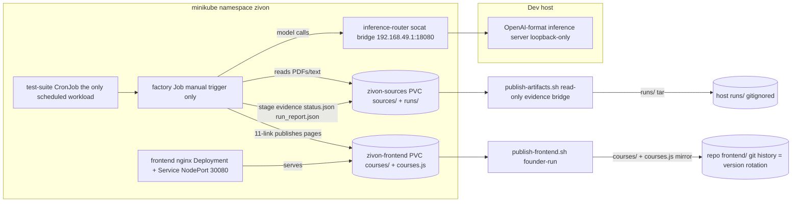
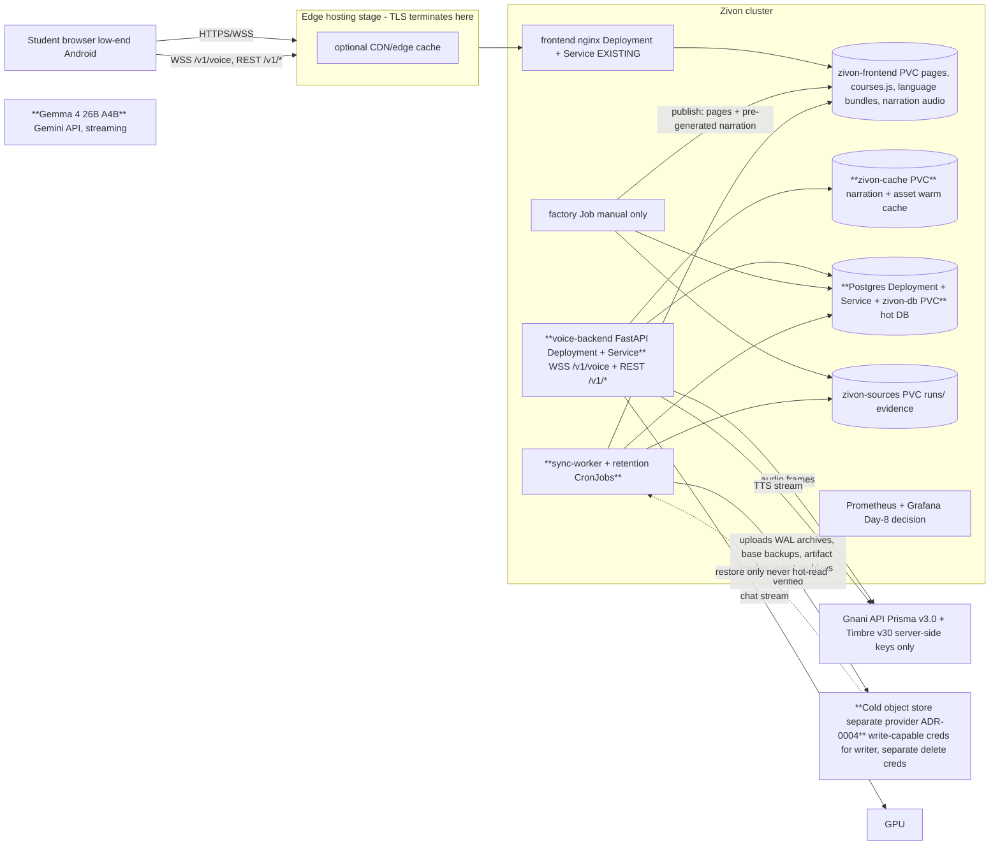

# Backend specification — Zivon

Stage-2 systems design (2026-11-07). Consumes `docs/product/backend-handoff.md` +
`features.md` + inventories; does not re-derive them. Gate D is frozen: the P0 slice below
is exactly the signed-off 16-P0 ladder's backend needs — nothing more. Every endpoint,
message, and table cites a Stage-1 ID (`NEED-`/`INF-`/`ENT?-`/`EVT-`) or is labelled
*systems-originated* with a reason. All numbers `[ASSUMPTION]` until measured.

---

## 1. Scope, decisions inherited, and the assumptions register

### 1.1 Inherited decisions (binding, not re-litigated)

- Voice stack: **Prisma v3.0** STT (`indic-auto`, `detected_language_code`) + **Timbre v3.0**
  TTS (13 polyglot voices, 13 expressive tags, tags billable as characters) — verified facts
  in `docs/DECISIONS-and-RESEARCH/02-all-about-gnani.md` addendum 12. Runtime LLM:
  **Gemma 4 26B A4B**, cloud-hosted via Google Gemini API (founder confirmed 2026-11-09; Gate A outcome — `docs/DECISIONS-and-RESEARCH/05-gate-a-brain-decision.md` + ADR-0017). Evon v3.3 is post-challenge aspiration — not
  designed against.
- Architecture: hybrid B+ — static curated content (Core) + on-demand page-anchored doubt
  tutor. Layer independence: Core (read/simulate/check) stays up when voice, TTS,
  translation runtime, or personalization is down.
- Infra: Docker + Kubernetes + GitHub Actions + GHCR; voice backend = Deployment + Service;
  factory = manual-trigger Job; frontend = nginx Deployment over `zivon-frontend` PVC;
  TLS terminates at the edge only; secrets runtime-only; CI key-free; `k8s/infra.env` is
  the config-values source of truth.
- Identity: no accounts, no auth for students (TIMELINE out-of-scope). Anonymous
  device-scoped pseudonymity with a nullable `guardian_ref` seam (T6). Consent gates the
  ADD layer only (voice input, transcripts, coverage server sync).
- **Founder corrections 2026-11-07 (Stage-2 session, recorded in Stage-1 docs):**
  1. Credit guard = **1,000 credits/day global tranche** + **30 credits/user/day**
     (free-trial scale; the earlier 200 default was a misunderstanding) + togglable
     `normal` ↔ `demo` profiles (demo = relaxed but bounded; exact numbers are a founder
     calibration item). **Credits meter only the voice agent** (Prisma STT + tutor Timbre
     TTS).
  2. Course-material narration is **pre-generated at build time and stored** (DB asset row
     + audio object), served statically — C-051 adopted; zero runtime TTS calls for
     read-aloud; no per-student credit burn.
  3. Everything except the voice agent is accessible **without login**; abuse/DDoS
     prevention is by **IP-keyed rate limiting** (hashed IP, short retention), applied
     especially to static audio/TTS assets and the realtime channel.
  4. Storage is **three distinct units**: backend cache (fast, small) · hot DB (Postgres,
     hosted alongside the backend) · cold storage (separate provider) — see §2 glossary and
     `storage-tiering.md`.

### 1.2 Assumptions register (Phase-1 validation output — gaps made explicit)

Phase-1 validation result: **all 18 NEEDs have a caller; all 105 INF rows have a source;
all 18 EVT events have an emitter** (verified mechanically against the inventories; see
§16 traceability). No requirement is silently dropped. The following gaps are carried as
explicit assumptions, each with an owner and a calibration trigger:

| # | Assumption | Value used | Owner / calibration trigger |
|---|---|---|---|
| A-01 | Gnani credit unit prices (credits per STT second, per TTS character) are not published in the repo | capacity model is parameterized; reconciliation table in `capacity-and-cost.md` | founder — read the Gnani dashboard before Gate-C rehearsal (already an ops action in features.md §7.3) |
| A-02 | "Transcripts: server log TTL 7 d" is implemented as **DB rows with a 7-day hard-delete TTL** (`voice_turn`), not log files; structured logs carry no transcripts (single system of record, enforceable deletion path) | 7 d hard delete | Stage-2 interpretation, recorded here; revisit if debugging proves insufficient (T11 falsification test) |
| A-03 | Per-user cap keyed on the client-generated `device_pseudo_id` is spoofable; it is abuse friction + budget hygiene, not identity (consistent with T6) | device_pseudo_id keying | accepted for demo; VPC design is a counsel item (C-087) |
| A-04 | Hinglish is a UI locale value (`hinglish`) beyond the 10 Gnani codes; STT hint maps `hinglish → en-IN` (mixed audio accepted), TTS maps `hinglish → hi-IN` on a v3.0 polyglot voice | enum of 11 locales | verify at Gate-C rehearsal (30-min v3.0 smoke test already scheduled) |
| A-05 | Demo-profile guard numbers: global tranche stays 1,000/day; per-user cap relaxes to 100/day `[ASSUMPTION]`; a hard total-remaining-budget ceiling applies in both profiles | 1,000 global / 100 per-user | founder calibration item (flagged in TIMELINE infra TODO) |
| A-06 | Guard warn threshold = 15 % of the daily tranche remaining | 15 % | founder (doc default in F-XCT-OFF-01) |
| A-07 | Traffic envelope: ≤ 500 sessions/day, ≤ 10 concurrent voice sessions, ≤ 20 turns/session, ≤ 30 events/session (handoff §5) | as stated | re-measure during submission week (judge traffic) |
| A-08 | Page-load gate: product target **< 2 s** (NEED-001); the factory perf gate is currently **loosened to 6.0 s load / 3.5 s FCP** by founder decision until first real measurements — both numbers are stated wherever the gate is cited | 2 s target / 6.0 s gate | re-tighten at Phase 4 (architecture.md § Performance budgets) |
| A-09 | Gemma 4 26B A4B serving must be a **cloud API with warm-path first-token budget** meeting first-token < 1.2 s; the dev inference-router path (single-slot local server, ~20 tok/s) does NOT meet Gate C — Gate-C rehearsal must run via the Gemini API | < 1.2 s first token | founder/ops — Gemini API key is a runtime Secret; hard dependency of Gate C |
| A-10 | Voice failure-count reset window (F-ADD-VOI-03 "3 consecutive failures") = **per session** | per session | Stage-2 decision (card open question assigned to Stage 2) |
| A-11 | Echo path (tutor speaker → mic): **client-side ducking** (pause read-aloud, duck media volume during tutor speech) + server-side gate as fallback flag; device-tested before Gate-C rehearsal | client ducking | frontend + device test (handoff §3 assigns the choice to Stage 2 — decided in ADR-0010) |
| A-12 | IP-based abuse tracking stores only a **salted daily-rotating hash of the IP** (HMAC), retention ≤ 72 h rolling window `[ASSUMPTION]`; raw IPs are never persisted or joined to pseudonymous data | 72 h | DPDP treats IP as personal data — minimization applied; counsel review post-challenge |
| A-13 | Cold provider regions: no candidate confirmed to have an India storage region yet; child-adjacent archives are **encrypted client-side before upload**; region/residency decision flagged for counsel | encrypt-then-upload | ADR-0004 + counsel (open legal question) |
| A-14 | SC-02 (sim unit/state-template fields) timing remains content-factory-owned (unchanged from Stage 1) | — | content factory |
| A-15 | Narration pre-generation build budget: bounded one-time Gnani-credit tranche for factory TTS, proposed ≤ 1,500 credits total `[ASSUMPTION]`, separate from the voice-agent daily tranche | ≤ 1,500 credits | founder approval before the first narration build run |

---

## 2. Glossary — the storage units and tier model (founder-mandated separation)

Three distinct storage units, plus the existing SSD-class PVCs. They are **separate
failure domains with separate credentials** wherever the tier boundary says so:

| Unit | What it is | Speed / size | Role | Failure domain |
|---|---|---|---|---|
| **U1 Backend cache** | In-process memory of the voice-backend pod (live session state, guard counters, warm caches) + an SSD cache volume (new PVC `zivon-cache`) holding narration audio + recently published assets | fastest, smallest, disposable | hot reads only; everything in U1 is a **copy** — loss is always survivable (re-warm from U2/U3 or regenerate) | compute pod / cluster |
| **U2 Hot database** | PostgreSQL 16, a Deployment + Service + PVC (`zivon-db`) **alongside the backend in-cluster** | fast, modest (GB class) | system of record for consent, ledgers, sessions, events, reports, catalogues; transactional guard decrements | cluster (same as compute — mitigated by continuous WAL archiving to U4) |
| **U3 SSD content volumes** | existing PVCs: `zivon-frontend` (live site), `zivon-sources` (factory `runs/` + source cache), `hf-cache` | fast, block storage | live workspace for serving + factory evidence | cluster |
| **U4 Cold storage** | S3-compatible object store at a **separate provider** (own account, own credentials, ideally different region; ADR-0004) | slow, cheap, durable | origin copies of immutable artifacts, DB WAL archive + base backups, event/ledger archives, consent snapshots; **never in the request path for hot reads** | external provider — deliberately independent of compute + U2 |

Tier vocabulary used across these specs: **hot** = U1/U2/U3 (in the cluster's failure
domain); **cold** = U4 (separate provider/account/credentials). *System of record (SoR)* =
the one authoritative place for a datum; anything else is a cache or backup.
*Cold-verified* = object uploaded, read-back checksum matched, catalogue row stamped
`cold_verified_at`. The eviction invariant (hard rule 4) applies to every class whose only
copy is on U1/U2/U3.

---

## 3. Phase plan — P0 slice vs target architecture

Gate D is frozen and the deadline is 10 Nov. Everything is labelled:
**P0** (must build now — serves the signed-off ladder), **P1** (Day-8/9 ladder: dashboard,
telemetry polish, language bar plumbing), **P2** (stretch), **post-challenge** (target
architecture; specified so migration is mechanical, not built now).

| Component | P0 slice (build now) | Target architecture (post-challenge) |
|---|---|---|
| Voice service | single FastAPI Deployment + Service, 1 replica, modular monolith with clean module seams | same monolith; split only when a measured NFR demands (ADR-0005) |
| Database | single Postgres 16 Deployment + Service + `zivon-db` PVC; Alembic migrations; core tables only | partitioned event/turn tables, read replicas only if measured, per-subject encryption keys |
| Session state | in-memory dict keyed by `session_id` + durable rows in U2 | Redis-like store only if > 1 replica or measured need (ADR-0002) |
| Credit guard | in-memory counters + Postgres ledger/counters; two dimensions + profile toggle; flag push over WS | same design; multi-pod counters via DB hot rows |
| Cold storage | one bucket at the chosen provider (ADR-0004); nightly CronJob mirroring PVCs + DB base backup; **publish-time synchronous upload+verify** for lesson bundles & narration (simple script step, no worker) | outbox table + sync-worker Deployment, WAL continuous archiving, partition archival, scrub + monthly restore drills, second cold copy for consent ledger + DB backups |
| Narration (NEED-017) | factory/publish-time Timbre generation → Opus objects on `zivon-frontend` PVC + DB asset rows; served statically by nginx | narration origin copies in cold; regeneration pipeline with reviewer gate per language |
| Abuse prevention | nginx `limit_req` (static + audio) + app token-bucket (API/WS) keyed on salted IP hash | geo/edge WAF at hosting stage |
| Admin | JSON API subset (summary, guard state/toggle, actions wrapping the three sanctioned scripts) behind an admin token | dashboard v0 UI (static + HTMX, F-OPS-ADM-01), audit UI, report inbox |
| Observability | structured JSON logs, per-stage voice latency histograms, Prometheus+Grafana (Day-8 decision), `/health` | traces, Loki (P2), SLO dashboards, synthetic probes |

The P0 slice is buildable inside the remaining window: one image, one DB, one bucket,
~9 student endpoints + ~8 admin endpoints + one WS protocol. Everything else is specified
so that post-challenge work is mechanical.

---

## 4. Architecture overview

### 4.1 Today's data flow (verified from the repo — Phase-0 exit test)

### 4.2 Target topology (new pieces in **bold**; everything else exists today)

### 4.3 Module seams inside the voice backend (AGENTS.md separation, kept as Python packages)

`voice/` (new top-level package, sibling of `factory/` — naming per skill reference 06):

| Module | Owns | Serves |
|---|---|---|
| `voice/session` | session bootstrap, resume tokens, flags, coverage store | NEED-003, NEED-011 |
| `voice/channel` | WebSocket endpoint, message envelope, ordering, backpressure, interruption | NEED-004 |
| `voice/audio` | mic frame intake (Opus), transient buffers, STT streaming client lifecycle; **buffer lifecycle per T11 — never persisted** | NEED-004, NEED-006 |
| `voice/gnani` | Prisma v3.0 + Timbre v3.0 API clients (server-side keys only), tag stripping harness | NEED-006, NEED-008 |
| `voice/tutor` | persona + prompt assembly (anchor payload, coverage summary, history window), Gemma client (OpenAI-format), streamed text, tag emission, redirect policy | NEED-005, NEED-007 |
| `voice/anchor` | context snapshot validation (≤ 4 KB), anchor resolution, provenance chip data | NEED-005 |
| `voice/guard` | credit metering at call points, two-dimension guard, profile toggle, state push | NEED-009 |
| `voice/telemetry` | event ingestion, schema validation against the 18-EVT catalogue, consent gating | NEED-010 |
| `voice/consent` | consent record store + server-side feature gating middleware | NEED-012 |
| `voice/privacy` | deletion pipeline orchestrator (NEED-013), retention job entry points | NEED-013 |
| `voice/reports` | problem-report intake (no PII fields accepted) | NEED-014 |
| `voice/admin` | admin query/action API wrapping the three sanctioned scripts (parity-tested), guard queries | NEED-015 |
| `voice/abuse` | IP-hash token buckets, per-session and per-IP limits | systems-originated (founder correction 3) |
| `voice/db`, `voice/catalog` | Postgres access layer, object catalogue, outbox rows | systems-originated |

Layer independence is enforced at deployment level (nginx Core survives everything) and at
the module level (voice failure never imports into content serving; guard/telemetry failures
are fire-and-forget with local queues).

---

## 5. NFR table (every row measurable, tagged, and traced)

Fixed-by-Stage-1 numbers are inherited, not re-derived. `[ASSUMPTION]` until measured;
`[FIXED]` = set by Stage 1 / founder decision.

| ID | Category | Requirement | Target | Status | Measure | Driven by | Owner |
|---|---|---|---|---|---|---|---|
| NFR-01 | Voice latency (Gate C) | end-of-speech (`ptt.stop`/endpoint) → first spoken audio byte at the client | **p50 ≤ 3.0 s, p90 ≤ 4.0 s** | `[ASSUMPTION]`; Gate-C gate is `< ~4 s` `[FIXED]` | EVT-006 per-stage histograms, server + client clocks | F-ADD-VOI-01, M2 | voice backend |
| NFR-02 | Voice stage | STT final after end-of-speech | ≤ 1.5 s | `[FIXED]` NEED-006 | per-stage timer | F-ADD-VOI-01 | voice backend |
| NFR-03 | Voice stage | LLM first token after STT final | < 1.2 s | `[FIXED]` NEED-007 | per-stage timer | F-ADD-VOI-04 | cloud API (ADR-0017) |
| NFR-04 | Voice stage | TTS first audio byte after text-stream start for that utterance | < 800 ms | `[FIXED]` NEED-008 | per-stage timer | F-ADD-VOI-01 | voice backend |
| NFR-05 | Voice control | barge-in: `interrupt` received → TTS output stopped + `turn.cancelled` | ≤ 300 ms | `[FIXED]` handoff §3 | WS timers | F-ADD-VOI-01 AC-3 | voice backend |
| NFR-06 | UX status | "thinking" cue after end-of-speech | ≤ 300 ms | `[FIXED]` P6 | client timer | F-ADD-VOI-01 | frontend |
| NFR-07 | Content latency | lesson page interactive on low-end Android | product target **< 2 s** `[FIXED]`; current factory perf gate **6.0 s load / 3.5 s FCP** (founder loosening until measured) — both numbers always cited together | `[ASSUMPTION]` pending first measurements | perf harness (`weak-android` profile) + RUM | NEED-001, F-COR-LES-01 | factory/frontend |
| NFR-08 | Read-aloud latency | first audio byte of a pre-generated narration asset | < 1.5 s p90 (static delivery — no runtime TTS call) | `[FIXED]` AC-1 F-WRP-TTS-01 (re-scoped by founder correction 2) | RUM | F-WRP-TTS-01 | nginx/static |
| NFR-09 | API latency | session bootstrap / coverage PUT / consent PUT | < 300 ms p95 each | `[FIXED]` NEED-003/011/012 | endpoint histograms | F-ADD-VOI-01, F-ADD-MEM-01, F-XCT-CON-01 | voice backend |
| NFR-10 | API latency | events ingestion added to interaction path / report submit / language-bundle fetch after switch | < 50 ms async / < 1 s / < 200 ms | `[FIXED]` NEED-010/014/016 | endpoint + client timers | F-OPS-TEL-01, F-COR-PROV-01, F-WRP-LAN-01 | voice backend/static |
| NFR-11 | Voice availability | voice session establishment success (WSS connect + first turn) | ≥ 99 % monthly | `[ASSUMPTION]` | success ratio probe | F-ADD-VOI-01 | voice backend |
| NFR-12 | Content availability | lesson bundles served (Core path) | ≥ 99.9 % monthly; independent of voice stack (probe both separately) | `[ASSUMPTION]` | synthetic uptime probe on `/courses/...` and `/v1/voice` separately | layer-independence rule | frontend/ops |
| NFR-13 | Concurrency / scale | simultaneous live voice sessions; daily volume | 10 concurrent `[FIXED]` A-07; 500 sessions/day `[FIXED]` A-07; sizing: voice pod 1 CPU / 512 Mi limit, 1 replica `[ASSUMPTION]` | load test at 2× envelope (20 concurrent) | voice backend |
| NFR-14 | Guard | credit counting overhead per call; guard-state push to open sessions | < 5 ms `[FIXED]` NEED-009; ≤ 5 s `[FIXED]` NEED-009 | per-call timers; EVT-008 lag | F-OPS-MET-01 | voice backend |
| NFR-15 | Telemetry | client batching; local queue | ≤ 20 events / ≤ 5 s batch; queue ≤ 200, drop-oldest | `[FIXED]` NEED-010 | client tests | F-OPS-TEL-01 | frontend |
| NFR-16 | Durability | lesson bundles, consent ledger, DB backups | ≥ 2 independent copies in ≥ 2 failure domains | `[FIXED]` method rule | restore drill evidence | storage-tiering §5 | ops |
| NFR-17 | RPO | hot Postgres (U2) | ≤ 5 min (WAL `archive_timeout = 60 s` + archive lag metric) | `[ASSUMPTION]` | archive lag metric | db-spec §7 | ops. **P0 SIMULATED (2026-11-10): no WAL shipping implemented — effective RPO = last `backend.sync` base backup (≤ 24 h); target not yet met** |
| NFR-18 | RPO | immutable published artifacts (bundles, narration) | 0 once published — the publish flip waits for a cold-verified copy | `[FIXED]` method rule (P0: synchronous publish-time verify) | catalogue state | storage-tiering SYNC-01 | factory/publish flow |
| NFR-19 | RTO | full service restore from cold (DB PITR + PVC mirrors re-seeded) | ≤ 4 h | `[ASSUMPTION]` | monthly drill timing | storage-tiering §6 | ops |
| NFR-20 | Integrity | cold copies checksum-verified on write; periodic scrub | 100 % verified on write; scrub 1–5 %/day sample | `[ASSUMPTION]` | scrub job report | storage-tiering §4 | sync worker |
| NFR-21 | Capacity | SSD/PVC headroom watermarks | alert > 70 %, evict-eligible cache > 75 %, page > 90 % | `[ASSUMPTION]` | volume metrics | storage-tiering §4 | ops |
| NFR-22 | Privacy | raw child audio stored | **none, ever** (transient buffer only, T11) | `[FIXED]` | storage audit (zero audio objects in U1–U4) | T11, F-XCT-CON-01 | voice backend |
| NFR-23 | Privacy retention clocks | transcripts 7 d hard delete; coverage 24 h idle TTL; telemetry 90 d; credit ledger 90 d; session rows 30 d; IP-hash abuse buckets ≤ 72 h; reports until resolved + 90 d | as listed | `[FIXED]` handoff §6 (+ A-12) | retention-job audit | handoff §6 | voice backend/ops |
| NFR-24 | Deletion SLA | guardian "clear my data" (NEED-013) | online wipe best-effort immediate (< 60 s p95 `[ASSUMPTION]`); full pipeline incl. cold/backup ageing ≤ 7 d target, DPDP 90-day posture post-challenge | `[ASSUMPTION]` | deletion-request completion timestamps | F-XCT-CON-01, NEED-013 | voice backend |
| NFR-25 | Ledger accuracy | local credit ledger vs Gnani dashboard | drift ≤ 2 % | `[FIXED]` AC-2 F-OPS-MET-01 | daily reconciliation job | F-OPS-MET-01 | voice backend |
| NFR-26 | Ops freshness | admin panels; run status | panels ≤ 5 min lag `[FIXED]`; run status ≤ 1 min `[FIXED]` INF-100 | panel timestamps | F-OPS-ADM-01 | voice backend |
| NFR-27 | Maintainability | deploy rollback | ≤ 10 min (K8s rollout undo + image tag rotation per gotcha 9) | `[ASSUMPTION]` | drill | repo conventions | ops |
| NFR-28 | Security | secrets in images/manifests/workflows; CI keys | zero (repo rule); CI key-free | `[FIXED]` | gitleaks + kube-linter in CI (exists) | AGENTS.md | ops |
| NFR-29 | Observability | trace id spans client → WS → STT → LLM → TTS → client playback | 100 % of voice sessions carry a `trace_id`; EVT-006 covers every completed turn | `[ASSUMPTION]` | trace sampling audit | F-OPS-TEL-01 | voice backend |
| NFR-30 | Ops access | admin views display only aggregated, non-identifying data; transcripts never shown on panels | by design (AC-4 F-OPS-ADM-01) | `[FIXED]` | panel audit | F-OPS-ADM-01 | voice backend |

---

## 6. API catalogue

Conventions (vendored `api-designer`): versioned under `/v1`; nouns for resources; **problem-details
error body** `{code, message_key, trace_id, retryable}` — `message_key` maps to the INF-068 copy set
so every error renders in the student's language, never raw model/stack text; OpenAPI generated from
the FastAPI app is the single source of truth (frontend types generated from it); `trace_id` on every
response (NFR-29). **Login-free by founder correction 3** — no student auth anywhere; abuse control
is the IP-hash bucket family (§8.3). All latency targets cite NFR-09/10.

### 6.1 Student endpoints (9 + 1 channel)

#### API-001 `POST /v1/session` — bootstrap + flags
- **Purpose:** open a lesson-page session; return pseudonymous session + feature flags. · **Serves:** NEED-003 · **Consumed by:** dock, lesson shell (F-ADD-VOI-01/03, F-XCT-CON-01)
- **Auth + consent:** none to call; reads latest `consent_record` for the device to compute flags. · **Request:** `{device_pseudo_id (uuid, validated), lang (locale enum), consent_state (client claim — server truth wins), page: {course_id, class}}`
- **Response:** `{session_id, session_token (short-lived, §8.1), flags: voice_enabled|typed_only|voice_off, consent_required: bool, guard_state: ok|warn|exhausted|reserved_mode}`
- **Errors:** `E-RATE-LIMIT`, `E-INTERNAL` (dock system-error copy; Core intact). · **Idempotency:** POST creates a new session per page visit (by design); retry-safe via client backoff.
- **Caching:** none. · **Rate limit:** api family 30/min/IP. · **p95:** < 300 ms (NFR-09).
- **Data touched:** `device`, `session`, `consent_record`, `guard_counter` (read). · **EVT:** — (client fires EVT-001).
- **Credit cost:** 0. · **Failure UI:** dock shows system-error state, Core page untouched. · **Version:** v1.

#### API-002 `WSS /v1/voice` — the voice channel
Full contract in **§7**, **as amended by ADR-0020** (implemented endpoint path `/voice/ws` on the
monolith mount; the mount decision and the concrete framing live there). Serves NEED-004
(+005/006/007/008 inside it). Auth: `session_token` at connect, re-validated at resume.
Consent-gated. Rate limit: ws family. Credit cost: the only
metered surface (Prisma s + Timbre chars + Gemma tokens).

#### API-003 `PUT /v1/session/{session_id}/coverage` — coverage store
- **Purpose:** persist covered-items at turn boundaries (server mirror of local-first memory). · **Serves:** NEED-011 · **Consumed by:** memory view (EL-LES-01-054), prompt assembly (NEED-005)
- **Auth + consent:** session_token; **server sync only with voice consent** — without consent the client keeps memory local-only (flag `coverage_synced=false`, "syncing later" copy). · **Request:** `{covered: [{block_id, type, status}]}` ≤ 32 items.
- **Response:** `{ok, coverage_synced: true}`. · **Errors:** `E-SESSION-EXPIRED` (client re-bootstraps), `E-RATE-LIMIT`.
- **Idempotency:** full-state PUT (last write wins, seq-guarded by `If-Match`-style `rev`). · **Caching:** none. · **Rate limit:** api family. · **p95:** < 300 ms.
- **Data touched:** `session.coverage`. · **EVT:** — · **Credit cost:** 0. · **Failure UI:** local continues. · **Version:** v1.

#### API-004 `PUT /v1/consent` — consent record store
- **Purpose:** append consent event (granted/declined/withdrawn). · **Serves:** NEED-012 · **Consumed by:** consent overlay (EL-LES-01-058…061), privacy page (EL-PRV-002)
- **Auth:** none (device-keyed). · **Request:** `{device_pseudo_id, consent_version, notice_version, guardian_flag, action: granted|declined|withdrawn, ts}`.
- **Response:** `{ok, consent_id}`. · **Errors:** `E-RATE-LIMIT`, `E-INTERNAL` (voice stays off; retry copy).
- **Idempotency:** append-only; duplicate same-action within 60 s deduped by `(device, action, minute)` partial. · **Caching:** none. · **Rate limit:** api family. · **p95:** < 300 ms.
- **Data touched:** `consent_record` (append). · **EVT:** EVT-013 (client-side). · **Credit cost:** 0. · **Version:** v1; consent_version changes supersede, never edit.

#### API-005 `POST /v1/events` — telemetry ingestion
- **Purpose:** batched event intake, schema-validated. · **Serves:** NEED-010 · **Consumed by:** all instrumented elements (F-OPS-TEL-01)
- **Auth + consent:** session_token optional for Core-safe events; **consent gate:** pre-consent only EVT-001/016/017 accepted (server-enforced). · **Request:** `{events: [{evt_id, session_id, course_id?, block_id?, props, ts, client_ts}]}` ≤ 20.
- **Response:** `{accepted: n, rejected: [{i, code}]}` — 200 even on partial reject (batch semantics). · **Errors:** whole-batch `E-RATE-LIMIT`; per-event `E-EVT-SCHEMA` (free-text keys rejected).
- **Idempotency:** per-event `event_uuid` from client (dedup unique). · **Caching:** none. · **Rate limit:** events family 12 batches/min/IP. · **p95:** < 50 ms added to interaction path (async write-behind to `telemetry_event`).
- **Data touched:** `telemetry_event`. · **Credit cost:** 0. · **Failure UI:** client local queue ≤ 200, retry backoff, drop-oldest. · **Version:** v1; catalogue version in props schema version field.

#### API-006 `POST /v1/reports` — problem report
- **Purpose:** correctness-loop intake. · **Serves:** NEED-014 · **Consumed by:** report form (EL-LES-01-040/041)
- **Auth:** none. **No PII fields accepted** — request schema has no name/contact keys; text ≤ 500 chars, child-safe flagged. · **Request:** `{course_id, class, block_id?, category: wrong_physics|bad_translation|broken_sim|other, text?}`.
- **Response:** `{report_id}`. · **Errors:** `E-RATE-LIMIT` (draft kept + "could not send"). · **Idempotency:** client `report_nonce` unique index 10-min window. · **Rate limit:** reports family 5/min/IP. · **p95:** < 1 s.
- **Data touched:** `problem_report`. · **EVT:** EVT-014 (client). · **Credit cost:** 0. · **Version:** v1.

#### API-007 `DELETE /v1/data` — right-to-erasure
- **Purpose:** device-scoped wipe. · **Serves:** NEED-013 · **Consumed by:** privacy page clear (EL-PRV-003/004)
- **Auth:** identity = `device_pseudo_id` + confirm token (client proves possession: server issues a one-time challenge at GET privacy page — friction, not identity, A-03). · **Request:** `{device_pseudo_id, confirm_token, scope: "device"}`.
- **Response:** `{deleted: {sessions, consents, events, turns, reports}}` counts (NEED-013 shape). · **Errors:** `E-CONFIRM-REQUIRED`, `E-RATE-LIMIT`, `E-INTERNAL` (ops alert + audit row).
- **Idempotency:** second call for a wiped device returns `{deleted: 0…}` + existing tombstone. · **Rate limit:** 3/min/IP.
- **Data touched:** `deletion_request` + fan-out per db-spec §6; pipeline per storage-tiering §6. · **EVT:** EVT-018 (client). · **Credit cost:** 0. · **Version:** v1.

#### API-008 `GET /v1/health` — liveness/readiness (systems-originated: ops requirement, db-spec §7)
- **Purpose:** probes + schema/release version. **Serves:** NFR-12 probes, deployment gates. · **Auth:** cluster-side.
- **Response:** `{status, db: ok, schema_version (alembic), release (image tag), guard_profile_mode}`. · **Caching:** none. · **p95:** < 100 ms. · **Credit cost:** 0.

#### API-009 `GET /v1/session/{session_id}` — resume check
- **Purpose:** revalidate token + fetch flags/coverage after reconnect (handoff §3 "auth re-validated at resume"). · **Serves:** NEED-003/011 resume path · **Auth:** session_token.
- **Response:** subset of API-001 response + `{coverage, rev}`. · **Errors:** `E-SESSION-EXPIRED` → client re-bootstraps. · **p95:** < 300 ms. · **Credit cost:** 0.

### 6.2 Static content contracts (nginx-served — Core path, survives every voice outage)

| ID | Contract | Serves | Rules |
|---|---|---|---|
| ST-01 | Lesson pages + assets `/courses/{course_id}/{class}/…` (exists today) | NEED-001 | content-addressed where hashed; `Cache-Control: public, max-age=3600` for shell, **`immutable, max-age=31536000`** for hashed page assets; strict CSP per Code Reviewer rules (no eval, no third-party hosts); stale manifest must still work (ref 04 §5) |
| ST-02 | `courses.js` catalogue (exists today, never hand-edited) | NEED-002 | `max-age=300` (hub freshness); shape fixed: `[{course_id, class, title, chapter, generated_at, path}]` |
| ST-03 | `GET /bundles/{course_id}.{lang}.json` (factory-generated, P1/SC-01) | NEED-016 | immutable (version in body + hash in path post-SC-01); `immutable, max-age=31536000`; lazy + SW cache on first switch; < 200 ms after switch (NFR-10); 404 → stay current language + "couldn't load" chip |
| ST-04 | `GET /audio/{course_id}/{block_id}.{lang}.{content-hash}.opus` (pre-generated narration) | NEED-017 | **immutable, max-age=31536000** (content-hash path); served from `zivon-frontend` PVC, warm-cached on `zivon-cache`; absent → INF-089 disabled copy (client probes HEAD or manifest availability flag); first byte < 1.5 s p90 (NFR-08); nginx audio-family rate limit per IP (founder correction 3) |

### 6.3 Admin endpoints (NEED-015 — separate surface, admin token, cluster-side; never student-facing)

All admin routes under `/v1/admin/*`, authenticated by **admin token** (K8s Secret; separate from
every student credential; AC-6 audit on every action; NFR-30 aggregate-only display).

| ID | Route | Purpose / parity | Serves |
|---|---|---|---|
| API-A1 | `GET /v1/admin/summary` | sessions today, credit burn (INF-097), guard state (INF-098), engagement aggregates (INF-099), open reports count — ≤ 5 min lag | NEED-015 |
| API-A2 | `GET /v1/admin/sessions?date=` | pseudonymous session rows (INF-096: id · topic · duration · turns — no free text) | NEED-015 |
| API-A3 | `GET /v1/admin/credits` | ledger totals + reconciliation drift % (AC-2 ≤ 2 %) + profile config | NEED-009/015 |
| API-A4 | `GET /v1/admin/guard` · `POST /v1/admin/guard/profile {mode}` | guard state read + **profile toggle** (normal↔demo) — writes `audit_log`, pushes `state` to open sessions ≤ 5 s | NEED-009 (founder toggle), NEED-015 |
| API-A5 | `GET /v1/admin/runs` · `GET /v1/admin/runs/{run_id}` | run status rows + stage durations (INF-100/101, ≤ 1 min lag) | NEED-015 |
| API-A6 | `GET /v1/admin/reports` · `PATCH /v1/admin/reports/{id} {status}` | report inbox (INF-104/105) | NEED-014/015 |
| API-A7 | `POST /v1/admin/actions/run-tests` | **wraps `scripts/trigger-tests.sh` semantics** (parity-tested; the sanctioned "button") | NEED-015 |
| API-A8 | `POST /v1/admin/actions/generate-topic {chapter, class, fresh?}` | **wraps `scripts/trigger-factory-run.sh`** (manual-only Job; never scheduled) | NEED-015 |
| API-A9 | `GET /v1/admin/actions/watch-run/{run_id}/logs` | **wraps `scripts/logs-factory-run.sh`** semantics (INF-103 stream) | NEED-015 |
| API-A10 | `GET /v1/admin/audit?from=` (P1) | audit log view (C13) | systems-originated |

Parity rule (AGENTS.md): A7/A8/A9 must be behaviourally identical to the scripts (same Job/CronJob
renders, same guards); CI parity test compares rendered manifests. Admin actions are async:
`202 {action_id}` + status via A5.

---

## 7. WebSocket catalogue — the voice loop (NEED-004)

### 7.1 Channel rules

- **Endpoint:** `WSS /v1/voice?session_token=…` — opened after bootstrap + consent; one channel per
  lesson-page visit; closes on navigation. TLS at the edge only (repo rule). Origin check on
  upgrade. Max 1 concurrent channel per session; cluster cap 10 concurrent (A-07; NFR-13).
  **As amended by ADR-0020:** the implemented route is `/voice/ws` (the same channel mounted on
  the monolith); `/v1/voice` is superseded for the P0 mount. An upgrade whose `Origin` host differs
  from the request `Host` (or from the configured allow-list) is rejected with **close 1008**;
  rate-limit rejections close **1013** and key on the pseudonymous device + resolved client IP
  (trusted-proxy aware, so an ingress peer does not collapse every client into one bucket).
- **Envelope (JSON frames):** `{v:1, type, id, seq, ts, session_id, turn_seq?, payload}`;
  **binary frames** for audio with 8-byte header `{codec: opus, rate: 16000, seq}`.
- **Ordering:** `turn_seq` monotonic per session (handoff §3); server-assigned down `seq` per
  turn; client dedupes by seq and may resume within 60 s (API-009 revalidate, replay window of
  final messages only — partials are never replayed).
- **Backpressure:** bounded server queues; under pressure **drop `stt.partial`/`tutor.text.delta`
  coalescing, never final messages**; client down-buffer ≤ 2 s audio → overflow drops chunks and
  shows transcript (text floor); client up-buffer > 1 s → stop mic, system-error + retry (context
  preserved). Max sizes: JSON ≤ 8 KB, `context.snapshot` ≤ 4 KB (NEED-005), audio frame ≤ 2 KB.
  **Superseded by ADR-0020 / ws-contract §3 for the voice mount:** uplink audio frames are PCM16
  mono 16 kHz at 100 ms = **3,200 bytes** (so the ingress bound is 3,200 B, not 2 KB), and the
  server tolerates up to 2× that (6,400 B) before dropping a frame, with downlink Opus 20 ms
  frames carrying the ADR-0020 8-byte header.
- **Heartbeat:** `ping`/`pong` every 30 s; 2 missed → close (session row stays; resume allowed).
  Idle channel close after 10 min without frames `[ASSUMPTION]`.
- **Barge-in (F-ADD-VOI-01 AC-3):** `interrupt` → server stops TTS consumption ≤ 300 ms (NFR-05),
  flushes queued `tts.chunk`, emits `turn.cancelled`; in-progress *turn* is never cut by guard
  (handoff §3 — guard exhaustion only blocks the *next* turn).
- **Echo path:** client-side ducking per A-11 (ADR-0010): dock pauses read-aloud/media audio while
  dock is speaking; server-side gate flag as fallback, device-tested before Gate-C rehearsal.

### 7.2 Message catalogue

Client → server (7):

| Type | Schema | Ordering/seq | Idempotent? | On loss | Billable? | Notes |
|---|---|---|---|---|---|---|
| `ptt.start` | `{turn_seq}` | opens turn | yes (same seq ignored) | client retries | no | mic opens only now (battery+privacy, handoff §3) |
| `audio.frame` | binary opus 16 kHz mono ≤ 20 ms | seq per turn | n/a | dropped by STT gap tolerance; > 1 s buffer → stop mic | **yes (STT s)** | only while listening; **transient buffer, never persisted (T11)** |
| `context.snapshot` | NEED-005 payload ≤ 4 KB | once per turn start | yes (latest wins) | turn proceeds with last snapshot + "I can't see…" honesty note (NEED-005 failure row) | no | validated by `voice/anchor` |
| `ptt.stop` | `{turn_seq}` | closes capture | yes | server endpointing may have fired first | no | starts the Gate-C clock |
| `typed.doubt` | `{turn_seq, text ≤ 1 000 chars}` | alternative turn opener | yes (seq) | client retries | **yes (LLM+TTS)** | typed path — same pipeline minus STT; works when STT down |
| `interrupt` | `{turn_seq}` | any time | yes | client shows stop state | no | ≤ 300 ms effect (NFR-05) |
| `ping` | `{}` | 30 s cadence | n/a | 2 missed → close | no | |

Server → client (10):

| Type | Schema | Ordering/seq | Idempotent? | On loss | Billable? | Notes |
|---|---|---|---|---|---|---|
| `stt.partial` | `{text, confidence}` | per turn | n/a | dropped under backpressure (never final) | no (already metered) | **only if user opted in** (EL-LES-01-048, INF-062 transient) |
| `stt.final` | `{text, confidence, language_detected}` | once per turn | replayable in resume window | client re-asks | no | low confidence → `no-match` error instead of garbled text (INF-060 fallback) |
| `tutor.text.delta` | `{chunk}` | seq per turn | coalesced on reconnect | text floor degrades gracefully | no (LLM metered at generation) | may precede audio — Gate-C enabler; tags stripped in UI (INF-061) |
| `tts.chunk` | binary audio chunk + seq | seq per turn | deduped by seq | overflow → drop + transcript (text floor) | **yes (TTS chars)** | unknown tags already stripped server-side (harness) |
| `tts.done` | `{seq}` | once per utterance | yes | client marks complete | no | |
| `turn.cancelled` | `{turn_seq}` | on interrupt | yes | — | no | interrupt ack |
| `turn.meta` | `{eos_ms, stt_final_ms, llm_first_token_ms, tts_first_byte_ms}` | once per turn | yes | EVT-006 fires server-side anyway | no | EVT-006 source; drives dock "thinking" cue ≤ 300 ms (NFR-06) |
| `state` | `{voice_enabled\|typed_only\|voice_off, reason_key}` | anytime | latest wins | client re-reads at bootstrap | no | guard-state push ≤ 5 s (NEED-009); in-progress turn completes |
| `error` | `{code, message_key, retryable, turn_seq?}` | anytime | n/a | — | no | §8.2 error model; copy from INF-068 set |
| `pong` | `{}` | heartbeat | n/a | — | no | |

### 7.3 Per-hop latency budget (sums against the fixed Stage-1 numbers — Gate C)

Fixed ceilings inherited: STT final ≤ 1.5 s (NFR-02), LLM first token < 1.2 s (NFR-03), TTS first
byte < 800 ms (NFR-04). The budget **overlaps stages** (ref 04 §4.2) — the pipeline never serializes:

| Hop | p50 target | Ceiling | Overlap lever |
|---|---|---|---|
| Client → server `ptt.stop` arrives | 50 ms | 150 ms | keep-alive WS (no handshake per turn) |
| STT finalize after end-of-speech | 600 ms | **1 500 ms** | Prisma streams partials during speech; server endpointing may fire **before** `ptt.stop` (handoff §3) — finalize starts early |
| LLM first token after STT final | 500 ms | **1 200 ms** | Gemini API first token (ADR-0017 — hard dependency); short system prompt; cached page context; history window ≤ 6 turns |
| First speakable clause (clause boundary after first token) | 200 ms | 400 ms | prompt requires short first sentence (NEED-007 "≤ 3 sentences default"); chunk on punctuation **and clause** |
| TTS first byte after clause handed to Timbre | 400 ms | **800 ms** | TTS starts on the first clause while the LLM continues generating the rest; connection reused; no cold start |
| Downlink + client decode + playback start | 150 ms | 300 ms | small first chunk; client decodes ahead |
| **Total Gate C** | **≈ 1.9 s p50** | **≤ 4.0 s p90** (ceilings sum to 4.05 s only if every stage hits its worst simultaneously — the levers above make that rare; histograms per EVT-006 decide) | — |

Long-pole rule: the first stage whose p90 exceeds its ceiling gets the fix before any feature work
(per-stage histograms are a P0 build requirement, not Day-8 polish — Gate C rehearsal depends on them).

---

## 8. Auth, consent, rate limits, credit guard

### 8.1 Session token (systems-originated — handoff §3 "short-lived session token")

`session_token` = HMAC-signed `{session_id, device_pseudo_id, iat, exp}` (exp 12 h, key from K8s
Secret, rotated per deploy; not an account, not refreshable beyond session life). Carried as
`?session_token=` on WSS connect and `Authorization: ZivonSession <token>` on REST calls that name
a session. Revalidated at resume (API-009). **No student accounts anywhere** (TIMELINE out-of-scope;
T6) — the token proves possession of the session, nothing more. Admin token is a separate K8s
Secret, cluster-side only.

### 8.2 Consent gating (server-side, not UI-side)

Middleware on: WSS connect, `audio.frame`/`typed.doubt` ingestion, coverage PUT, consent-gated EVT
ingestion. Rule: derived-latest `consent_record.action = granted` for the device, else
`E-CONSENT-REQUIRED` → flags recompute to `voice_off` (Core untouched). Withdrawal takes effect on
the next gated call (in-progress turn completes, handoff §3). Consent version bump (notice text
change) forces re-consent: middleware returns `E-CONSENT-STALE` → overlay re-shows.

### 8.3 Rate limits & abuse prevention (founder correction 3 — login-free but IP-keyed)

Two layers, both keyed on the **salted daily-rotating IP hash** (A-12; raw IP never persisted):

| Layer | Scope | Limits `[ASSUMPTION]` (tune at submission week) |
|---|---|---|
| nginx `limit_req` (existing frontend Deployment) | static pages, `courses.js`, bundles, **narration audio** (ST-01…04) | static 100 req/min/IP burst 20; audio 60/min burst 10 |
| app token buckets (`voice/abuse`, `abuse_bucket` table) | API-001…009, WSS connects, events, reports | api 30/min; ws 10 connects/min + 1 concurrent/session + 10 cluster-wide; events 12 batches/min; reports 5/min; DELETE /data 3/min |

On breach: `429 {code: E-RATE-LIMIT, retry_after}`; WS close code 1013 + backoff hint. DDoS posture:
limits are per-IP; cluster-level connection caps + edge WAF at hosting stage (phase plan §3).
EVT-009 counts rate-limit hits for ops (no free text).

### 8.4 Credit metering & the two-dimension guard (NEED-009)

- **Metered surface (founder correction 1):** Prisma STT seconds + tutor Timbre TTS characters +
  Gemma tokens (cloud-hosted — tracked for capacity, not Gnani credits). **Pre-generated narration
  is never metered per student** (C-051; served statically).
- **Meter at call points** (`voice/guard` wraps `voice/gnani` + `voice/tutor`): quantity known at
  call end → `credit_ledger` row (async) + hot-counter decrement.
- **Enforce before the turn** (AP-02/03, < 5 ms): atomic upsert-reserve on `guard_counter` for
  (period, global) AND (period, device) — both must have headroom for an estimated turn cost
  (≈ 15 s STT + 600 chars TTS `[ASSUMPTION]` from handoff §5 per-turn figures). Mid-turn soft
  checks stop *further* generation; **an in-progress turn is never cut** (handoff §3).
- **States:** `ok` → `warn` (remaining ≤ 15 % of tranche, A-06: warn notice before sessions start,
  INF-085) → `exhausted` (global → all new sessions `typed_only`; per-user → that device only,
  INF-086) → `reserved_mode` (demo profile active). Push via `state` message ≤ 5 s (NFR-14).
- **Profiles:** `normal` 1 000 global / 30 per-user (founder config); `demo` 1 000 / 100
  `[ASSUMPTION A-05]` — toggled via API-A4, logged to `audit_log`, flips `guard_profile` row.
  Hard ceiling in both profiles: total remaining programme budget minus a **demo reserve**
  (repo rule ~40 % for demo/judges — enforced as a `reserved` bucket cap, not a note).
- **Degrade ladder (never a hard wall):** shorter replies (≤ 2 sentences) → typed_only → read-only
  (voice_off). Honest allowance shown (INF-085/086 copy).
- **Reconciliation:** nightly job compares ledger totals vs Gnani dashboard; drift > 2 % → alert
  (AC-2, NFR-25); daily usage log export (repo rule "log usage daily").

---

## 9. Failure-mode table (every component; what the *student* sees)

| Component | Failure | Detect | Student sees | Auto response | Runbook | Data at risk |
|---|---|---|---|---|---|---|
| voice-backend pod | crash / OOM | pod restart count, liveness fail | dock → system-error state ("try again"); Core page fully intact | K8s restart; client reconnect + resume (API-009); in-flight turn lost (C5 memory — by design) | RB-02 | ≤ 1 turn of context; no durable data |
| voice-backend pod | event-loop stall (latency regression) | EVT-006 p90 breach, healthz latency probe | slow answers; text floor may appear | shed load: disable partials → shorter replies → typed_only ladder | RB-09 | none |
| WSS channel | dropped connection | heartbeat loss (2 missed pings) | dock "reconnecting"; last transcript stays | resume within 60 s window (finals replayed); else re-bootstrap | RB-09 | none |
| Gnani Prisma (STT) | API down / timeout | error class E-STT-UNAVAILABLE rate | dock: no-match/retry copy (INF-067/068); **typed path still works** | degraded rung 1: typed_only for new turns; retry with backoff | RB-08 | none (audio never stored) |
| Gemma brain (Gemini API) | down / quota / slow | first-token p90 breach; probe fail | dock system-error + retry; Core + read-aloud unaffected | circuit-break LLM calls (fail fast, don't queue); typed path also halts (same brain) | RB-09, RB-02 (rebuild from C15 copy) | none |
| Gnani Timbre (TTS) | API down / tag errors | E-TTS-UNAVAILABLE rate | **text floor**: transcript + captions; audio skipped | degraded rung: text-only replies; resume audio on recovery | RB-08 | none |
| U2 Postgres | pod/PVC loss | probe fail, connection errors | bootstrap fails → dock system-error; **static pages + narration keep loading** (Core independence) | failover to restored instance (storage-tiering §6.1); voice backend refuses new voice turns meanwhile | RB-02 | ≤ 5 min of ledger/turn rows (RPO) |
| U2 Postgres | connection pool exhaustion | pool wait metric | slow bootstrap/coverage saves | queue + shed telemetry first (fire-and-forget queues) | RB-01 | telemetry batch (client queue holds) |
| U1 cache | full | usage > 75 % | nothing (cache is invisible) | evict cold-verified LRU (EVICT-01); never unverified | RB-01 | none if invariant holds |
| U3 `zivon-frontend` PVC | loss | probe / 404 spike | hub/pages fail → offline chip | re-seed from U4/git (≤ 2 h); nginx serves stale-allowed shell | RB-02 | 0 for published versions (publish gate) |
| U3 `zivon-sources` PVC | loss mid-run | factory Job error | nothing (students never see it) | run resumes from completed stages; archived runs re-seed | RB-02 | run evidence since last nightly mirror |
| U4 cold provider | unreachable | upload errors, outbox backlog age | nothing | queue outbox; **eviction disabled**; lifecycle jobs pause | RB-03 | artifacts not yet cold-verified (publish holds) |
| U4 | corrupt object returned | scrub checksum mismatch / read-back fail | nothing | quarantine + re-upload from hot copy | RB-06 | single object |
| edge/nginx | down / rate-limit misconfig | synthetic probe (NFR-12) | offline chip; "couldn't load" chips | client SW cache serves last pages; limits auto-relax on window end | RB-01 | none |
| credit guard | counter drift vs Gnani dashboard | nightly reconciliation > 2 % | nothing (or premature typed_only) | recompute counters from ledger; alert founder | RB-08 | none |
| credit guard | exhausted (global) | state flip | INF-086 typed-only copy; voice off for new turns | ladder: shorter replies → typed_only; **in-progress turns complete** | RB-08 | none |
| telemetry pipeline | ingestion down | EVT-009 + batch reject rate | nothing (invisible) | client queue ≤ 200, drop-oldest; server write-behind retries | RB-04 | telemetry ≤ 200 events/device |
| consent middleware | stale notice version | E-CONSENT-STALE | consent overlay re-shows | voice off until re-ack; Core intact | RB-10 | none |
| client | offline | client-side | offline chip; dock disabled with reason | local memory + event queue; sync on restore (EVT-016) | — | ≤ 200 queued events |
| deletion pipeline | step failure | request status `failed` + audit | privacy page error copy (INF-094) | retry steps idempotently; ops alert; tombstone already exists | RB-10 | partial wipe window (bounded by retry SLA) |

**Layer-independence check (checklist item):** every row above that touches voice/TTS/LLM/guard
leaves the Core row (ST-01…04 static serving) explicitly working. The reverse never happens: no
Core failure row disables voice *and* content simultaneously except total edge loss, which the
client SW cache softens.

---

## 10. Security & privacy design

### 10.1 Data map & processors (the classification table *is* the record of processing)

Processors/sub-processors per data flow (for the DPDP register, post-challenge counsel pass):
**Gnani API** (Prisma receives streamed audio for transcription — retention policy at Gnani is
**[verify — ask before scale-up]**; Timbre receives tutor text) · **Google Gemini API** (Gemma — cloud; page context + history window leaves the cluster to Google — external processor) · **Backblaze B2 / Cloudflare
R2** (cold archives, encrypted for child-adjacent classes) · **GitHub** (git snapshots — public-repo
risk: `frontend/` snapshot contains only public content; **runs/ evidence stays gitignored**) ·
**hosting/edge** (TBD at hosting stage). Cross-border: B2/R2 storage regions are US/EU (no India
region — matrix §5) → **counsel question Q-L1 open**; mitigation live now: client-side envelope
encryption for C9/C14/C10 uploads (A-13).

### 10.2 Engineering controls (minors-by-default)

- **Minimization enforced in schema, not policy:** `voice_turn.audio_retained CHECK false`; no
  audio objects possible (C7 rule + storage audit assertion); telemetry has no free-text column;
  `sim_state` capped at 4 KB; transcripts 7-d hard delete with no cold copy.
- **Pseudonymity:** random client-generated `device_pseudo_id` (UUIDv4); no device fingerprinting;
  no third-party analytics SDKs (repo rule); IP stored only as salted daily-rotating HMAC (A-12).
- **Consent as middleware** (§8.2), not UI: voice, coverage-sync, and gated EVT refuse without
  a granted record; withdrawal effective next call.
- **No profiling by construction (T5):** `device` table has no behavioural columns; memory is
  session-scoped coverage (J5), 24 h TTL, student-visible and clearable (EVT-018); any future
  inferred item must carry `explanation` + be deletable (db-spec target note) — table absent today.
- **Deletion pipeline** §storage-tiering 6.2 (DB → cold → caches-assert → logs-assert → audit →
  tombstone + re-delete list).
- **Access control:** least-privilege DB roles (voice app role cannot DROP; sync worker has its
  own role; admin API separate token); humans have **no standing access** to transcripts (admin
  panels display aggregates only — NFR-30; rubric sampling of transcripts requires consent per
  INF-060 visible_to row and happens on a time-boxed export, logged to `audit_log`); break-glass
  = founder + logged + reviewed.
- **Secrets:** K8s Secrets runtime-only (Gnani keys, DB URL, session-token key, admin token,
  cold-provider 3 identities, IP-hash salt); gitleaks + kube-linter already in CI (NFR-28);
  Gnani keys never reach the browser (server-side only, handoff §1).

### 10.3 STRIDE-style threat pass (brief, per vendored `secure-code-guardian`)

| Threat | Vector | Mitigation |
|---|---|---|
| Spoofing | forged `device_pseudo_id` to claim consent state / drain another device's cap | caps are budget hygiene not identity (A-03); consent keyed on device id the caller must present + confirm token for DELETE; no per-device *read* API exists (nothing to steal) |
| Tampering | poisoned lesson bundle in PVC | publish gate: sha256 + cold-verify before live; git snapshot diffable; CSP blocks injected eval |
| Repudiation | "I did consent / I didn't" | append-only consent ledger with notice_version; audit_log hash-chained (target) |
| Information disclosure | PII in logs / object keys / admin panels | zero-PII log rule + CI log-pipeline audit; keys never contain PII; panels aggregate-only |
| DoS | audio flood, WS connect storm, credit exhaustion (burning *our* credits) | §8.3 buckets (audio family, ws family); cluster concurrent cap 10; guard is also a DoS damper — exhausted = typed_only not crash |
| Elevation | admin UI compromise | admin token cluster-side, separate secret; actions limited to the three sanctioned scripts + guard toggle; every action audited |
| Supply chain | new deps (boto3/b2sdk, asyncpg, alembic), models | dependabot (exists), image scanning in CI (exists), small dep set rule (AGENTS.md) |
| Prompt injection | page text / transcripts into Gemma prompt | treat all page + transcript content as data (delimited blocks in prompt template); anchor payload is structured JSON, validated ≤ 4 KB; tutor system prompt forbids instruction-following from quoted content; output tag allow-list enforced by harness |

### 10.4 Breach readiness

Detection (anomaly alerts + scrub + audit review) → triage (founder, 1 h) → **DPDP Board
notification clock 72 h [verify — secondary source, counsel required]** → affected-device notice
via privacy page copy + remediation runbook → post-incident log entry. Rehearsed as part of the
restore drill agenda (RB-12 includes a tabletop breach walk-through, P1).

---

## 11. Observability, SLOs, runbooks

### 11.1 Signals (aligned to the Day-8 Prometheus/Grafana decision — no parallel stack)

- **Golden signals** per service (voice backend, nginx, Postgres, sync worker): rate, errors,
  duration, saturation + PVC usage per volume.
- **Voice path:** per-stage histograms from `voice_turn.latency` + EVT-006 (eos, stt_final,
  llm_first_token, tts_first_byte) — the Gate-C instrument; `trace_id` propagated client → WS →
  STT → LLM → TTS → playback ack (NFR-29, 100 % of sessions).
- **Tiering metrics:** outbox backlog age, cold-verification lag, WAL archive lag, SSD/PVC usage
  + eviction rate, scrub drift count, last successful drill timestamp, deletion-request age
  (storage-tiering §3 alerts bind to these).
- **Product health (from EVT aggregates, pseudonymous):** sessions/day, turns + resolved-doubt
  rate, first-attempt check correctness (EVT-004), fallback rates (typed_only, text floor,
  no-translation), credit burn/hour, p95 first-audio latency (M1–M7 mapping).
- **Structured JSON logs, zero transcripts/PII** (CI-audited pattern); Loki = P2 per repo decision.

### 11.2 SLOs + error budgets `[ASSUMPTION]` (review after first measurement week)

| SLO | Target | Error budget | On breach |
|---|---|---|---|
| Voice first-audio (completed turns ≤ 4.0 s p90 monthly) | 99 % of turns | 1 % of turns/month | freeze voice feature changes; RB-09 review (Gate-C posture) |
| Voice session establishment | 99 % | 1 % | RB-08/RB-09 review |
| Core content availability (probe ST-01/02) | 99.9 % | 43 min/month | page > 90 % or edge issue → RB-01 |
| API p95 latency (bootstrap/coverage/consent) | 99 % < 300 ms | 1 % | pool/index review |
| Publish → cold-verified | 99 % ≤ 5 min | 1 % | RB-04 |
| WAL archive lag | 99 % ≤ 5 min | 1 % | RB-02 |
| Deletion pipeline completion | 100 % ≤ 7 d | 0 | RB-10 (legal clock) |

Alert routing (vendored `sre-engineer` rule): **page only** on voice first-audio p90 breach,
outbox stuck > 15 min, WAL lag > 5 min, PVC > 90 %, scrub drift, deletion SLA breach. Everything
else = ticket. Synthetic probes: page-load probe + voice probe (scripted typed.doubt round-trip,
hourly, P1).

### 11.3 Runbooks (one page each — owners named; P0 set rehearsed once before submission)

| ID | Scenario | First actions | Owner |
|---|---|---|---|
| RB-01 | PVC ≥ 90 % / pool exhaustion | confirm invariant → evict verified LRU or add volume; never evict unverified | ops/founder |
| RB-02 | node/PVC/DB loss & restore | storage-tiering §6.1 order; re-delete list before cutover | founder |
| RB-03 | cold provider outage | disable eviction; pause lifecycle; watch backlog age; second provider unaffected | ops |
| RB-04 | sync backlog / upload failure storm | inspect outbox errors; bounded retry; manual drain; publish gate stays held | ops |
| RB-05 | credential leak (any cold identity) | rotate identity; writer key rotation ≤ 15 min; audit scan for junk uploads; quarantine suspects | founder |
| RB-06 | corrupted cold object | quarantine state; re-upload from hot; scrub full-class re-check | ops |
| RB-07 | bad content publish & rollback | flip `live_pointer` to previous version (one UPDATE); narration follows version pointer; post-mortem to factory reviewer | content |
| RB-08 | credit exhaustion / guard anomaly | ladder states; dashboard reconciliation; founder decides demo-profile flip (logged); never mid-turn cut | founder |
| RB-09 | voice latency regression | histogram diff per stage → fix long pole first (no feature work during breach) | voice dev |
| RB-10 | deletion request / pipeline failure | re-run idempotent steps; verify tombstone; SLA clock visible | ops |
| RB-11 | suspected breach | RB steps: contain → triage 1 h → counsel/Board clock decision → notify path → log | founder |
| RB-12 | restore drill (monthly; P0 once) | timed full restore + smoke test + re-delete check + tabletop breach walk-through | founder + ops |

---

## 12. Deployment topology (K8s objects — consistent with `docs/deployment/`, numeric apply-order prefixes)

New objects (target form; P0 subset marked ●):

| Manifest (prefix = apply order) | Object | Notes |
|---|---|---|
| `k8s/00-namespace.yaml` (exists) | namespace `zivon` | unchanged |
| `k8s/16-db-pvc.yaml` ● | PVC `zivon-db` (10 Gi demo) + PVC `zivon-cache` (5 Gi) | new volumes justified by data classes C11/C20/C6 (db) and C1/C2 warm cache — the ref-05 §5 rule "add volumes only with a data-class justification" |
| `k8s/25-postgres.yaml` ● | Postgres 16 Deployment + Service + Secret `zivon-db-env` (runtime-only) + ConfigMap `zivon-db-config` (archive_timeout=60 etc.) + readiness/liveness probes | the only new stateful workload; gotchas 9/12 apply (image tags pinned in manifest; kube-linter gates) |
| `k8s/25-core-backend.yaml` ● (+ `26-`, `27-`, `28-` monolith bundle) | Core backend Deployment + Service (FastAPI monolith incl. `voice/` router, image `zivon-backend:x.y.z` pinned — **no separate `zivon-voice` image** per ADR-0020) | envFrom Secret `zivon-voice-env` (Gnani keys, `ZIVON_VOICE_GEMINI_API_KEY`, DB URL, session-token key, IP-hash salt) + ConfigMap `zivon-voice-config` (limits, `ZIVON_VOICE_BRAIN_TRANSPORT`) |
| `k8s/25-core-backend.yaml` (Service part) ● | Service (ClusterIP + edge at hosting stage; dev parity NodePort 30080) | TLS terminates at the edge only (locked 2026-11-04) |
| `k8s/51-sync-worker.yaml` (P1 sync worker; plan reservation 51–53) | sync-worker Deployment (P1) + Secrets `zivon-cold-writer` / `zivon-cold-deleter` / `zivon-cold-restore` (three identities, storage-tiering §5) | separate service accounts; writer key has no delete |
| `k8s/53-sync-cronjobs.yaml` ● | CronJobs: sync-nightly, base-backup, ttl-voice-turn, ttl-coverage, ttl-abuse-bucket, rollup-daily-stats, ttl-telemetry (storage-tiering §6.3 P0 rows) | CronJob cleanup = history limits, no ttlSeconds inside jobTemplate (gotcha 12); the **factory Job stays manual-only** — nothing here changes `k8s/20` |
| `k8s/25-core-backend.yaml` (admin router) ● | admin routes live **inside** the core-backend monolith (incl. voice router) (separate router + token), not a separate service | simplicity; separate NetworkPolicy later if needed |
| CI (`.github/workflows/ci.yml`) | new jobs: build `zivon-backend` image (slim base, deps-before-code, non-root), smoke test parity with `docker/smoke_test.py` pattern, Alembic migrate-against-fresh-DB + migrate-against-cold-restore (ADR-0016), script-parity test (API-A7/8/9 vs the three scripts), kube-linter on new manifests | key-free (repo rule); third-party actions stay SHA-pinned |
| `k8s/infra.env` additions | `ZIVON_VOICE_GEMINI_API_KEY` (name only; value in Secret), `ZIVON_VOICE_BRAIN_TRANSPORT`, `COLD_PROVIDER="b2"`, `COLD_BUCKET_*` names (no secrets — keys live only in Secrets) | rendered by `scripts/apply-k8s.sh` like existing values |

Gemma brain (ADR-0017): **cloud API, no GPU host in P0** — reached via Google Gemini API key (`ZIVON_VOICE_GEMINI_API_KEY`, runtime Secret); OpenRouter route is a config-selected fallback transport. There is no `VOICE_LLM_BASE_URL` / GPU manifest in P0 (the dev inference-router bridge is the factory/llm-manager path, not the voice path).

## 13. Capacity & cost

Full model in [`capacity-and-cost.md`](capacity-and-cost.md). Headline: storage/egress ≈ $0
through the challenge window (B2 + R2 free tiers cover ≤ 8 GB cold total); the **binding
constraint is Gnani credits** (10 000 total · 1 000/day tranche · 30/user/day · ~40 % demo
reserve · ≤ 1 500 narration build budget A-15); the only real money lines are Gemini API usage + Gnani credits (no GPU host).

## 14. ADR index

[`adr/README.md`](adr/README.md) — 16 records, 1:1 map to the eight features.md ADR flags
(T2→0009, T3→0010, T5→0011, T6→0007, T7→0012, T8→0013, T11→0008, T12→0014) plus eight
systems-origin decisions (0001, 0002, 0003, 0004, 0005, 0006, 0015, 0016).

## 15. Open questions & unverified facts (consolidated — none smoothed over)

| # | Question | Where carried | Owner / trigger |
|---|---|---|---|
| A-01…A-15 | the full assumptions register (credit unit prices, demo-profile numbers, hinglish mappings, GPU warmth, IP-hash retention…) | §1.2 table | per-row owners |
| Q-L1 | **India data residency for child-adjacent archives** — B2/R2 have no India region; S3 ap-south-1 / GCS ap-south1 are the designated swap candidates | ADR-0004, storage-tiering §5 | founder + counsel before any scale-up (mitigation live: encrypt-then-upload A-13) |
| Q-L2 | DPDP clocks (72-h Board notice, 90-d rights response, children's-consent mechanics) are secondary-source facts | §10.4, ref 06 | counsel (already flagged Stage-1 C-087) |
| Q-V1 | **Gnani-side retention of streamed audio/text at the API** — unknown; we minimize on our side but must ask Gnani | §10.1 [verify] | founder — ask Gnani before scale-up; irrelevant to demo integrity |
| Q-V2 | B2 Object Lock / versioning feature pages; R2 lock/versioning status; multipart checksum semantics for the verify step | ADR-0004 [verify cells], SYNC-01 | Stage-3 build (before enabling lock) |
| Q-V3 | Wasabi + AWS/GCS region prices not verified this session (pages unreachable/unparseable) — cells flagged, no blog numbers used | storage-tiering §5 | re-verify only if ADR-0004 revisit fires |
| Q1…Q6 | DB-specific open questions (credit unit costs, crypto-erasure, guardian_ref, narration pace, class CHECK, partition thresholds) | db-spec §10 | per-row |
| Q-O1 | demo-profile numbers (1 000/100) are A-05 `[ASSUMPTION]` — founder calibration | §1.2, TIMELINE infra TODO | founder before demo day |
| Q-O2 | page-load gate duality (2 s target vs 6.0/3.5 s loosened gate) must always be cited together | NFR-07, A-08 | re-tighten at Phase 4 (Day 9) |

## 16. Traceability (NEED ↔ endpoint ↔ entity ↔ class ↔ EVT)

Machine-readable twins: [`db-traceability.csv`](db-traceability.csv) (column-level) and
[`data-classification.csv`](data-classification.csv) / [`sync-policy.csv`](sync-policy.csv).
The roll-up:

| NEED | Endpoint / mechanism | Tables | Data classes | EVT side |
|---|---|---|---|---|
| 001 | ST-01 static (nginx, exists) | content_page, page_version, live_pointer | C1 | 001 |
| 002 | ST-02 courses.js (exists) | content_page | C1 | 017 |
| 003 | API-001 POST /v1/session (+009 resume) | device, session, consent_record, guard_counter | C20, C9 | — |
| 004 | API-002 WSS /v1/voice (§7) | session, voice_turn | C5, C6, C7 | 005, 006, 010 |
| 005 | context.snapshot message → voice/anchor | voice_turn.anchor | C5 | — |
| 006 | voice/gnani Prisma client (inside 004) | voice_turn, credit_ledger | C6, C7, C11 | 005 |
| 007 | voice/tutor Gemma client (inside 004) | voice_turn, credit_ledger | C6, C11 | 005, 006 |
| 008 | voice/gnani Timbre client (inside 004) | voice_turn, credit_ledger | C6, C11 | 006 |
| 009 | voice/guard + guard_counter/guard_profile + API-A3/A4 | credit_ledger, guard_counter, guard_profile | C11 | 007, 008 |
| 010 | API-005 POST /v1/events | telemetry_event | C10 | all 18 (ingest side) |
| 011 | API-003 PUT coverage | session.coverage | C5 boundary | — |
| 012 | API-004 PUT /v1/consent + middleware | consent_record | C9 | 013 |
| 013 | API-007 DELETE /v1/data + pipeline | deletion_request + fan-out | C18 (+ all personal classes) | 018 |
| 014 | API-006 POST /v1/reports | problem_report | C17 | 014 |
| 015 | API-A1…A10 admin (script-parity A7-A9) | daily_stats, session, factory_run, problem_report, audit_log | C20, C4, C13, C17 | aggregates of all |
| 016 | ST-03 bundles (static) | language_bundle | C3 | 011 |
| 017 | ST-04 narration (static) | narration_asset, object_catalog | C2 | 012 |
| 018 | client localStorage (no endpoint) | — (device seam only) | C8 | 015 |

**Zero-orphans check (mechanical, 2026-11-07):** NEED 18/18 covered · EVT 18/18 have a home ·
INF 105/105 have a home or are storage-free shell-static/client-local rows · ENT? 10/10 mapped
to tables · WS messages 14/14 catalogued · data classes 20/20 rendered in both twin files ·
sync rules 10/10 labeled in both twins. No orphans.
