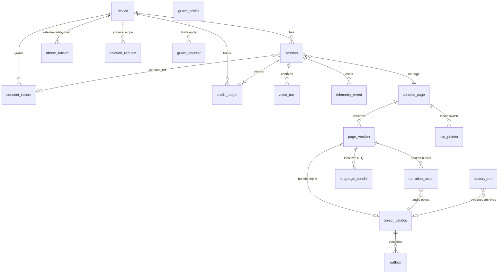

# Database specification — Zivon

Stage-2 systems design (2026-11-07). The schema for the **hot database (U2)** and its
retention/deletion behaviour. Consumes `docs/product/backend-handoff.md` §2 (ENT? entities),
§4 (EVT catalogue), §5–6 (volumes, retention) and the inventories; does not re-derive them.
Every column cites an `INF-`/`ENT?-`/`EVT-`/`NEED-` ID or is tagged **systems-originated**
with a reason. Tier placement per class is in `storage-tiering.md` §2; this document defines
the tables themselves.

---

## 1. Scope, engine, phase plan

- **Engine: PostgreSQL 16** (ADR-0001). Rationale in one line: consent ledger + credit guard
  need atomic transactions; content versioning needs relational integrity; JSONB holds block
  specs/bundles (validated by the existing `factory/schemas.py` layer, not the DB alone);
  WAL archiving is the backbone of the cold-sync design (storage-tiering §3). SQLite was the
  main alternative — rejected for concurrent writers + the weak WAL-to-cold story; see ADR-0001.
- **Placement:** single Postgres Deployment + Service + PVC `zivon-db` in-cluster (U2),
  following the repo's Deployment+Service pattern (`docs/deployment/kubernetes.md`). One
  logical database `zivon`.
- **Access layer:** SQLAlchemy 2.x async + asyncpg, Alembic migrations (ADR-0016). Python +
  type hints per AGENTS.md.
- **Phase plan:** §4 marks every table **P0** (build now), **P1**, or **target**
  (post-challenge). P0 = the tables the 16-P0 ladder actually touches. Partitioning,
  read replicas, per-subject encryption keys are target-only until a measured NFR demands them.
- What is **not** in the DB: raw audio (C7 — never stored, T11), device settings (C8 —
  client localStorage is the SoR, NEED-018), chrome UI strings (shell static in the repo —
  INF-001…008, 014…017, 020…021, 034…036, 038, 042…043, 050, 053…059, 063, 065…068, 070…071,
  075…076 labels, 080…086, 089…095, 102 are repo-owned strings, not DB rows), logs/metrics
  (C12 observability stack), run evidence files (C4 on PVC; only a read-side index table here).

---

## 2. Entity list (ENT? → tables)

| Stage-1 entity | Table(s) | Class | Phase |
|---|---|---|---|
| ENT?-Session | `session`, `daily_stats` (roll-up) | C20, C5 boundary | P0 |
| ENT?-VoiceTurn | `voice_turn` | C6 | P0 |
| ENT?-ConsentRecord | `consent_record` | C9 | P0 |
| ENT?-DeviceProfile | `device` (server anchor only — profile fields stay client-local) | C8 seam | P0 (anchor) |
| ENT?-CreditLedger | `credit_ledger`, `guard_counter`, `guard_profile` | C11 | P0 |
| ENT?-TelemetryEvent | `telemetry_event` | C10 | P0 |
| ENT?-ProblemReport | `problem_report` | C17 | P0 (intake) |
| ENT?-PageMeta | `content_page`, `page_version` | C1 | P0 |
| ENT?-RunStatus | `factory_run` (read-side index of `runs/` evidence) | C4 | P0 |
| ENT?-LanguageBundle | `language_bundle` | C3 | P1 (SC-01) |
| (narration asset — founder correction 2, NEED-017) | `narration_asset` | C2 | P0 |
| (tiering machinery — systems-originated) | `object_catalog`, `outbox` | all C* | P0 (catalog) / P1 (outbox worker) |
| (identity/privacy machinery — systems-originated) | `deletion_request`, `audit_log`, `abuse_bucket` | C18, C13, C19 | P0 |

`device` is systems-originated: consent, guard caps, sessions, and deletion all key on
`device_pseudo_id`, so the server needs one anchor row per device even though the *profile*
is client-local (NEED-018). It deliberately has **no** profile fields (T5 preclusion).

---

## 3. ER diagram

---

## 4. Per-table specification

Conventions (systems-originated, applied everywhere): PKs are **UUIDv7** (time-ordered,
never sequential-exposed, never PII-encoded) except where noted; all times `timestamptz` UTC;
`created_at` NOT NULL default now; locale enum = the 10 Gnani codes + `hinglish` (A-04):
`('bn-IN','en-IN','gu-IN','hi-IN','kn-IN','ml-IN','mr-IN','pa-IN','ta-IN','te-IN','hinglish')`.

### 4.1 `device` — pseudonymous anchor (C8 seam, P0)

| Column | Type | Null | Default | Source | PII class | Retention |
|---|---|---|---|---|---|---|
| device_pseudo_id | text (PK; client-generated UUIDv4, format-validated) | ✗ | — | ENT?-Session.device_pseudo_id; NEED-003/012/013 | pseudonymous | until deletion request |
| first_seen_at | timestamptz | ✗ | now | systems-originated (guard/ops) | pseudonymous | as above |
| last_seen_at | timestamptz | ✗ | now | systems-originated | pseudonymous | as above |
| locale | locale enum | ✓ | 'en-IN' | INF-063 lang setting (server copy at bootstrap only) | pseudonymous | as above |

Keys/constraints: PK. No name/contact/fingerprint columns — **T5 preclusion is a schema
constraint**: no behavioural columns exist to write to. Deletion path: NEED-013 hard-deletes
the row (cascades below); a `deletion_request` tombstone (4.16) keeps the evidence.
Volume: ≤ ~2 000 rows over the challenge window `[ASSUMPTION]`. SoR: U2.

### 4.2 `session` — session metadata (C20, ENT?-Session, P0)

| Column | Type | Null | Default | Source | PII class | Retention |
|---|---|---|---|---|---|---|
| session_id | uuid7 (PK) | ✗ | gen | ENT?-Session.session_id | pseudonymous | 30 d rows |
| device_pseudo_id | text FK→device ON DELETE CASCADE | ✗ | — | ENT?-Session | pseudonymous | 30 d |
| course_id | text | ✓ | — | INF-009 (topic context; INF-096 admin row "topic") | pseudonymous | 30 d |
| class_level | int (CHECK 6–12) | ✓ | — | INF-006 | pseudonymous | 30 d |
| lang | locale enum | ✗ | — | ENT?-Session.lang; INF-011/077 | pseudonymous | 30 d |
| mode | text CHECK in ('guide','tell') | ✗ | 'guide' | INF-079 (ENT?-VoiceTurn.mode) | pseudonymous | 30 d |
| consent_ref | uuid FK→consent_record ON DELETE SET NULL | ✓ | — | ENT?-Session.consent_ref ("nullable until consent", T6) | pseudonymous | 30 d |
| guardian_ref | text | ✓ | — | ENT?-Session.guardian_ref **nullable by design (T6)** — post-challenge counsel path only | child-adjacent | until deletion request |
| flags | jsonb `{voice_enabled, typed_only, voice_off}` (schema documented) | ✗ | '{}' | ENT?-Session.flags; NEED-003 | pseudonymous | 30 d |
| coverage | jsonb `[{block_id,type,status}]` ≤ 32 items | ✓ | '[]' | ENT?-Session.coverage; INF-069; NEED-011 | child-data (flagged) | 24 h idle TTL (job) |
| started_at / ended_at | timestamptz | ✗ / ✓ | now / — | systems-originated (INF-096 duration) | pseudonymous | 30 d |
| turn_count | int | ✗ | 0 | INF-096 | pseudonymous | 30 d |
| coverage_synced | bool | ✗ | false | NEED-011 consent-gated server sync flag | pseudonymous | 30 d |

Keys: PK; FK device. Indexes: `session(device_pseudo_id, started_at desc)` (AP-11 deletion
lookup, AP-04 resume); `session(started_at)` (AP-07 admin rows, INF-096).
Retention: nightly roll-up into `daily_stats` then **hard delete at 30 d** (INF-096 TTL).
Volume: ≤ 500/day (A-07). SoR: U2; cold: rides C14 backups only.

### 4.3 `voice_turn` — the Gate-C measurement row (C6, ENT?-VoiceTurn, P0)

| Column | Type | Null | Default | Source | PII class | Retention |
|---|---|---|---|---|---|---|
| turn_id | uuid7 (PK) | ✗ | gen | systems-originated | — | 7 d |
| session_id | uuid FK→session ON DELETE CASCADE | ✗ | — | ENT?-VoiceTurn | pseudonymous | 7 d |
| turn_seq | int | ✗ | — | ENT?-VoiceTurn.turn_seq; handoff §3 (monotonic per session) | pseudonymous | 7 d |
| modality | text CHECK ('voice','typed') | ✗ | — | ENT?-VoiceTurn.modality | pseudonymous | 7 d |
| transcript | text | ✓ | — | INF-060 (final student utterance) | **child-data (flagged)** | **7 d hard delete** |
| tutor_text | text | ✗ | — | INF-061 | child-adjacent | 7 d |
| tags | text[] | ✗ | '{}' | ENT?-VoiceTurn.tags; CHECK `tags <@` the 13-tag Timbre v3.0 catalog | pseudonymous | 7 d |
| detected_lang | locale enum | ✓ | — | NEED-006 `detected_language_code`; EVT-005 language_detected | pseudonymous | 7 d |
| anchor | jsonb `{block_ids[], sim_values{}}` ≤ 4 KB | ✓ | — | ENT?-VoiceTurn.anchor; NEED-005 | pseudonymous | 7 d |
| latency | jsonb `{eos_ms, stt_final_ms, llm_first_token_ms, tts_first_byte_ms}` | ✗ | — | ENT?-VoiceTurn.latency; EVT-006; Gate C | operational | 7 d |
| redirect_flag | bool | ✗ | false | ENT?-VoiceTurn.redirect_flag (off-topic redirect, F-ADD-VOI-04) | operational | 7 d |
| mode | text CHECK ('guide','tell') | ✗ | 'guide' | ENT?-VoiceTurn.mode | pseudonymous | 7 d |
| audio_retained | bool | ✗ | false, **CHECK (audio_retained = false)** | ENT?-VoiceTurn ("always false", T11) — the CHECK makes the rule schema-enforced | — | 7 d |
| created_at | timestamptz | ✗ | now | systems-originated (TTL clock) | — | 7 d |

Keys: PK; **UNIQUE (session_id, turn_seq)** (idempotent turn writes, handoff §3 ordering).
Indexes: `voice_turn(created_at)` (TTL scan); `voice_turn(session_id, turn_seq)`.
Retention: TTL job deletes rows where `created_at < now() - interval '7 days'` (handoff §6;
A-02). NEED-013 deletes device-scoped rows immediately. **Never archived to cold** (C6).
Volume: ≤ 10 000 rows/day at envelope (A-07). SoR: U2 only.

### 4.4 `consent_record` — append-only ledger (C9, ENT?-ConsentRecord, P0)

| Column | Type | Null | Default | Source | PII class | Retention |
|---|---|---|---|---|---|---|
| consent_id | uuid7 (PK) | ✗ | gen | systems-originated | child-data (legal evidence) | until deletion request |
| device_pseudo_id | text FK→device ON DELETE CASCADE | ✗ | — | ENT?-ConsentRecord | child-data | as above |
| consent_version | text | ✗ | — | ENT?-ConsentRecord.consent_version; INF-076 | child-data | as above |
| notice_version | text | ✗ | — | systems-originated (which notice text was shown — DPDP evidence) | child-data | as above |
| guardian_flag | bool | ✗ | — | ENT?-ConsentRecord.guardian_flag; INF-073 | child-data | as above |
| action | text CHECK ('granted','declined','withdrawn') | ✗ | — | ENT?-ConsentRecord (append-only versions) | child-data | as above |
| source | text CHECK ('overlay','imported') | ✗ | 'overlay' | ENT?-ConsentRecord.source | child-data | as above |
| recorded_at | timestamptz | ✗ | now | ENT?-ConsentRecord.ts | child-data | as above |

Keys: PK. No UPDATE/DELETE by application — append-only; effective consent is **derived**
(latest action per device), never overwritten. Index: `consent_record(device_pseudo_id,
recorded_at desc)` (AP-01 bootstrap gate, AP-10 middleware). Retention: until deletion
request (handoff §6); daily immutable snapshot to cold (storage-tiering §3 SYNC-03).
Volume: ≤ 500/day `[ASSUMPTION]`. SoR: U2; cold snapshot C9.

### 4.5 `credit_ledger` + `guard_counter` + `guard_profile` — metering & guard (C11, ENT?-CreditLedger, NEED-009, P0)

`credit_ledger` (append-only, counts only — **never content**):

| Column | Type | Null | Default | Source | PII class | Retention |
|---|---|---|---|---|---|---|
| entry_id | uuid7 (PK) | ✗ | gen | systems-originated | operational | 90 d hot |
| session_id | uuid FK→session ON DELETE SET NULL | ✓ | — | ENT?-CreditLedger context | pseudonymous | 90 d |
| device_pseudo_id | text FK→device ON DELETE CASCADE | ✗ | — | per-user cap keying (A-03) | pseudonymous | 90 d |
| model | text CHECK ('prisma','timbre','gemma_gpu') | ✗ | — | ENT?-CreditLedger.model — **deviation recorded:** `evon_gpu` → `gemma_gpu` per Gate A outcome 2026-11-07 | operational | 90 d |
| units | text CHECK ('seconds','chars','tokens') | ✗ | — | ENT?-CreditLedger.units | operational | 90 d |
| amount | numeric CHECK (amount ≥ 0) | ✗ | — | ENT?-CreditLedger.amount | operational | 90 d |
| bucket | text CHECK ('daily','reserved') | ✗ | 'daily' | ENT?-CreditLedger.bucket (reserved = demo-profile tranche) | operational | 90 d |
| cost_credits | numeric | ✓ | — | systems-originated — unit prices unknown (A-01); filled after dashboard calibration | operational | 90 d |
| created_at | timestamptz | ✗ | now | ENT?-CreditLedger.ts | operational | 90 d |

Indexes: `credit_ledger(created_at)` (TTL/archive); `credit_ledger(device_pseudo_id,
created_at)` (per-user daily totals for reconciliation, INF-097). Volume: ≤ 40 000/day
`[ASSUMPTION]` (2–4 metered calls × 20 turns × 500 sessions). Retention: 90 d hot then
monthly cold archive (C11). NOT deleted by NEED-013 — no subject content (documented).

`guard_counter` (hot rows, the only table read **inside the voice hot path**):

| Column | Type | Null | Default | Source | PII class | Retention |
|---|---|---|---|---|---|---|
| counter_id | uuid7 (PK) | ✗ | gen | systems-originated | operational | current period only |
| period | date | ✗ | — | daily tranche clock (NEED-009) | — | — |
| scope | text CHECK ('global','device') | ✗ | — | NEED-009 two dimensions | — | — |
| scope_key | text ('global' or device_pseudo_id) | ✗ | — | NEED-009 | pseudonymous (device rows) | — |
| used_credits | numeric CHECK (used_credits ≥ 0) | ✗ | 0 | systems-originated (hot counter) | operational | — |
| state | text CHECK ('ok','warn','exhausted','reserved_mode') | ✗ | 'ok' | NEED-009 state push; INF-098; EVT-008 | operational | — |
| updated_at | timestamptz | ✗ | now | systems-originated | — | — |

Keys: **UNIQUE (period, scope, scope_key)**. Turn-start check + decrement is one atomic
`INSERT … ON CONFLICT … UPDATE … RETURNING` (ADR-0015) — no read-then-write race. Index:
the unique key serves AP-02/03 (< 5 ms, NFR-14). Retention: rows older than current period
deleted nightly (aggregates live in `daily_stats`).

`guard_profile` (single current row — the togglable profile, NEED-009 founder decision):

| Column | Type | Null | Default | Source | PII class | Retention |
|---|---|---|---|---|---|---|
| id | int PK CHECK (id = 1) | ✗ | 1 | systems-originated (singleton) | — | forever |
| mode | text CHECK ('normal','demo') | ✗ | 'normal' | NEED-009 guard profile toggle | — | forever |
| global_tranche | numeric | ✗ | 1000 | NEED-009 founder config | — | forever |
| per_user_cap | numeric | ✗ | 30 | founder correction 1 (30/day free-trial scale) | — | forever |
| demo_global_tranche | numeric | ✗ | 1000 | A-05 `[ASSUMPTION]` | — | forever |
| demo_per_user_cap | numeric | ✗ | 100 | A-05 `[ASSUMPTION]` — founder calibration item | — | forever |
| warn_threshold_pct | numeric | ✗ | 15 | A-06 (F-XCT-OFF-01 default) | — | forever |
| updated_at / updated_by | timestamptz / text | ✗ | now / admin token label | systems-originated — every flip also writes `audit_log` (C13, F-OPS-MET-01 "logged toggle") | — | forever |

### 4.6 `telemetry_event` — 18-event catalogue (C10, ENT?-TelemetryEvent, P0)

| Column | Type | Null | Default | Source | PII class | Retention |
|---|---|---|---|---|---|---|
| event_id | uuid7 (PK) | ✗ | gen | systems-originated | pseudonymous | 90 d hot |
| evt_id | text CHECK in 18 values `EVT-001…EVT-018` | ✗ | — | handoff §4 catalogue | per-EVT class | 90 d |
| session_id | uuid FK→session ON DELETE CASCADE | ✓ | — | ENT?-TelemetryEvent.session_id | pseudonymous | 90 d |
| device_pseudo_id | text FK→device ON DELETE CASCADE | ✗ | — | systems-originated (deletion scoping) | pseudonymous | 90 d |
| course_id / block_id | text / text | ✓ | — | ENT?-TelemetryEvent; EVT props | pseudonymous | 90 d |
| props | jsonb, **schema-typed per EVT row** (validated in app against the catalogue; CI test rejects free-text keys) | ✗ | '{}' | handoff §4 properties column | pseudonymous/operational | 90 d |
| ts / client_ts | timestamptz / timestamptz | ✗ / ✓ | now / — | ENT?-TelemetryEvent.ts; systems-originated (client batching skew) | pseudonymous | 90 d |

Keys: PK. **No free-text column exists** — the schema itself enforces "no raw child free
text, ever" (handoff §4). Indexes: `telemetry_event(ts)` (partition/TTL);
`telemetry_event(evt_id, ts)` (AP-07 aggregates); `telemetry_event(device_pseudo_id)`
(AP-11 deletion). Volume: ≤ 15 000/day at envelope (30/session × 500). Retention: 90 d hot
(handoff §6) then cold archive (target, C10); consent gate enforced at ingestion (pre-consent
only EVT-001/016/017). Partitioning by day = target (revisit at > 1 M rows `[ASSUMPTION]`).

### 4.7 `problem_report` (C17, ENT?-ProblemReport, P0 intake)

| Column | Type | Null | Default | Source | PII class | Retention |
|---|---|---|---|---|---|---|
| report_id | uuid7 (PK) | ✗ | gen | ENT?-ProblemReport.report_id | pseudonymous | resolved + 90 d |
| course_id | text | ✗ | — | ENT?-ProblemReport.page_id; INF-104 | pseudonymous | as above |
| block_id | text | ✓ | — | ENT?-ProblemReport | pseudonymous | as above |
| category | text CHECK ('wrong_physics','bad_translation','broken_sim','other') | ✗ | — | ENT?-ProblemReport.category enum(4); INF-054 codes fixed | pseudonymous | as above |
| text | text (≤ 500 chars app cap; child-safe flagged; no PII solicited) | ✓ | — | ENT?-ProblemReport.text; INF-104 excerpt | child-safe free text | as above |
| status | text CHECK ('open','fixed','shipped_next_run') | ✗ | 'open' | ENT?-ProblemReport.status; INF-105 | operational | as above |
| created_at / resolved_at | timestamptz | ✗ / ✓ | now / — | ENT?-ProblemReport.ts; systems-originated (retention clock) | — | as above |

Index: `problem_report(status, created_at)` (ops inbox, INF-104). Volume: ≤ 20/day
`[ASSUMPTION]`. SoR: U2; cold: rides C14 backups only.

### 4.8 Content versioning — `content_page`, `page_version`, `live_pointer` (C1, ENT?-PageMeta, P0)

`content_page` (stable identity — extends, does not redesign, `courses.js`/manifest):

| Column | Type | Null | Default | Source | PII class | Retention |
|---|---|---|---|---|---|---|
| course_id | text (PK part) | ✗ | — | INF-009; ENT?-PageMeta.course_id | public | forever |
| class_level | int CHECK 6–12 (PK part) | ✗ | — | INF-006 | public | forever |
| title | text | ✗ | — | INF-005/010 | public | forever |
| chapter | text | ✓ | — | INF-006 | public | forever |
| created_at | timestamptz | ✗ | now | systems-originated | — | forever |

`page_version` (immutable after publish — the version-rotation row; git `frontend/` remains
the repo-side rotation, `publish-frontend.sh` parity):

| Column | Type | Null | Default | Source | PII class | Retention |
|---|---|---|---|---|---|---|
| page_version_id | uuid7 (PK) | ✗ | gen | systems-originated | — | forever |
| course_id / class_level | text / int FK→content_page | ✗ | — | ENT?-PageMeta | public | forever |
| version | text (e.g. run id + date) | ✗ | — | systems-originated (versioning pattern, ref 03 §3) | public | forever |
| status | text CHECK ('draft','reviewed','published','retired') | ✗ | 'draft' | systems-originated (version lifecycle) | — | forever |
| sha256 | text | ✗ | — | systems-originated (integrity; publish gate verify) | — | forever |
| size_bytes | bigint | ✗ | — | systems-originated (perf gate, A-08) | — | forever |
| manifest | jsonb (block list, hashes, narration availability, per ref 04 §5) | ✗ | — | ENT?-PageMeta (manifest.json extension — "do not redesign what exists") | public | forever |
| sources | jsonb array ≥ 1 | ✗ | — | INF-051; ENT?-PageMeta.sources (fact gate) | public | forever |
| block_counts | jsonb | ✓ | — | ENT?-PageMeta.block_counts | public | forever |
| translation_flags | jsonb | ✓ | '{}' | ENT?-PageMeta.translation_flags (post SC-01) | public | forever |
| run_id | text | ✓ | — | ENT?-RunStatus.run_id (provenance to `runs/`) | internal | forever |
| generated_at / published_at | timestamptz | ✗ / ✓ | now / — | INF-052; systems-originated | public | forever |

Keys: **UNIQUE (course_id, class_level, version)**; CHECK `status <> 'published' OR
(published_at IS NOT NULL AND cold_verified object exists)` — enforced at the publish
transaction (NFR-18: the flip waits for cold-verify; P0 synchronous check).
Rule: a published version is **never updated**; fixes create a new version (ref 03 §3).

`live_pointer` (the only mutable switch):

| Column | Type | Null | Default | Source | PII class | Retention |
|---|---|---|---|---|---|---|
| course_id / class_level | text / int | ✗ | — | as above | public | forever |
| locale | locale enum | ✗ | 'en-IN' | T2 revision (full Gnani set; demo subset en/hi/hinglish) | public | forever |
| page_version_id | uuid FK→page_version | ✗ | — | systems-originated (live switch) | public | forever |
| updated_at | timestamptz | ✗ | now | systems-originated (rollback = repoint, runbook) | — | forever |

PK `(course_id, class_level, locale)`. Index: `live_pointer(page_version_id)` (retire check).

### 4.9 `narration_asset` — pre-generated audio catalogue (C2, NEED-017, P0)

| Column | Type | Null | Default | Source | PII class | Retention |
|---|---|---|---|---|---|---|
| asset_id | uuid7 (PK) | ✗ | gen | systems-originated | — | per version forever |
| course_id / class_level / block_id | text / int / text | ✗ | — | NEED-017 path `/audio/{course_id}/{block_id}.{lang}.{hash}.opus` | public | as above |
| locale | locale enum | ✗ | — | NEED-017 `{lang}` | public | as above |
| voice | text (Timbre v3.0 voice id) | ✗ | — | NEED-008 voice catalog (tutor voice choice, ADR-0009 companion) | public | as above |
| speed | numeric CHECK in (0.75, 1.0, 1.25) | ✗ | 1.0 | INF-078 pace options — narration generated per pace only if measured need `[ASSUMPTION: 1.0 only in P0]` | public | as above |
| page_version_id | uuid FK→page_version ON DELETE CASCADE | ✗ | — | systems-originated (version scoping) | public | as above |
| text_hash | text (sha256 of spoken text) | ✗ | — | ref 03 §3 — identical text never regenerates (credit protection) | — | as above |
| object_id | uuid FK→object_catalog | ✗ | — | systems-originated (audio bytes live in the catalogue, not the DB) | — | as above |
| duration_ms | int | ✓ | — | systems-originated (INF-089 availability + perf) | — | as above |
| created_at | timestamptz | ✗ | now | systems-originated | — | as above |

Keys: **UNIQUE (course_id, class_level, block_id, locale, text_hash, voice, speed)**.
Index: `narration_asset(course_id, class_level, block_id, locale)` (publish-time manifest
build; static serving uses the hashed path, not the DB). Volume: 90–270 objects per 6-topic
batch `[ASSUMPTION]` (handoff §5). SoR: catalogue row U2 + object origin U4; served from U3/U1.

### 4.10 `language_bundle` (C3, ENT?-LanguageBundle, P1 — SC-01)

| Column | Type | Null | Default | Source | PII class | Retention |
|---|---|---|---|---|---|---|
| bundle_id | uuid7 (PK) | ✗ | gen | systems-originated | — | per version forever |
| page_version_id | uuid FK→page_version ON DELETE CASCADE | ✗ | — | ENT?-LanguageBundle.page_id | public | forever |
| locale | locale enum | ✗ | — | ENT?-LanguageBundle.lang (Gnani 10 + hinglish) | public | forever |
| strings | jsonb `block_id+field → text` (schema per SC-01) | ✗ | — | ENT?-LanguageBundle.strings; INF-014…017, 049 | public | forever |
| mt_flag / reviewed_flag | bool / bool | ✗ | false / false | ENT?-LanguageBundle; INF-088 | public | forever |
| status | text CHECK ('draft','reviewed','published','retired') | ✗ | 'draft' | systems-originated (reviewer gate before a language ships) | — | forever |
| version | text | ✗ | — | ENT?-LanguageBundle.version | public | forever |

Keys: UNIQUE (page_version_id, locale). Immutable when published. Volume: 10–30 KB per
page-language (handoff §5).

### 4.11 `object_catalog` — tiering machinery (systems-originated, storage-tiering core, P0)

| Column | Type | Null | Default | Source | PII class | Retention |
|---|---|---|---|---|---|---|
| object_id | uuid7 (PK) | ✗ | gen | ref 02 §3 catalogue | — | forever (row outlives object) |
| class_id | text (C1…C20) | ✗ | — | storage-tiering §2 | — | — |
| key | text UNIQUE (content-addressed or date-partitioned; **never PII in keys**) | ✗ | — | ref 02 §4 | — | — |
| sha256 / size_bytes / content_type | text / bigint / text | ✗ | — | ref 02 §3 | — | — |
| version_ref | text | ✓ | — | ref 02 §3 (page_version_id / run_id / period) | — | — |
| ssd_path | text | ✓ | — | ref 02 §3 (U1/U3 location) | — | — |
| cold_provider / cold_key | text / text | ✓ | — | ref 02 §3 (provider per ADR-0004) | — | — |
| cold_verified_at / evicted_at | timestamptz | ✓ | — | ref 02 §3 — **the eviction invariant's enforcement columns** | — | — |
| retention_until | timestamptz | ✓ | — | ref 02 §3 | — | — |
| pinned | bool | ✗ | false | ref 02 §3 (live + demo lessons pinned) | — | — |
| subject_ref | text | ✓ | — | systems-originated (device_pseudo_id for deletion fan-out; NULL for public artifacts) | pseudonymous when set | — |
| encryption_key_ref | text | ✓ | — | systems-originated (A-13 encrypt-then-upload; keys held outside U4) | — | — |
| state | text CHECK ('ssd_only','uploading','cold_verified','evicted','deleting','deleted','quarantined') | ✗ | 'ssd_only' | ref 02 §3 | — | — |
| created_at | timestamptz | ✗ | now | systems-originated | — | — |

Indexes: `object_catalog(key)` (unique, AP-15); `object_catalog(class_id, state)` (scrub +
retention scans); `object_catalog(subject_ref)` (deletion fan-out); partial index on
`cold_verified_at IS NULL` (outbox backlog alert, NFR ops metric).

### 4.12 `outbox` — sync jobs (systems-originated, ref 02 §3.1, P1 worker / P0 table)

| Column | Type | Null | Default | Source | PII class | Retention |
|---|---|---|---|---|---|---|
| outbox_id | bigserial PK | ✗ | — | systems-originated (queue needs cheap ordering) | — | processed rows pruned at 30 d |
| idempotency_key | text UNIQUE | ✗ | — | ref 02 §3.1 (double-upload protection) | — | — |
| object_id | uuid FK→object_catalog ON DELETE CASCADE | ✓ | — | systems-originated | — | — |
| job_type | text CHECK ('upload','verify','archive','delete','snapshot') | ✗ | — | storage-tiering §3 rules SYNC-01…06 | — | — |
| payload | jsonb | ✗ | '{}' | systems-originated | — | — |
| attempts | int | ✗ | 0 | systems-originated (bounded retry + backoff) | — | — |
| next_retry_at | timestamptz | ✓ | — | systems-originated | — | — |
| created_at / processed_at | timestamptz | ✗ / ✓ | now / — | systems-originated (backlog-age metric) | — | — |

Index: partial on `processed_at IS NULL ORDER BY created_at` (worker poll, AP-14; backlog
age = oldest unprocessed `created_at`).

### 4.13 `factory_run` — read-side index of run evidence (C4, ENT?-RunStatus, P0)

| Column | Type | Null | Default | Source | PII class | Retention |
|---|---|---|---|---|---|---|
| run_id | text PK | ✗ | — | ENT?-RunStatus.run_id | internal | mirrors hot-run window (last 10) |
| topic / class_level | text / int | ✓ / ✓ | — | ENT?-RunStatus | internal | — |
| stage | text | ✓ | — | ENT?-RunStatus.stage (factory stage names) | internal | — |
| verdict | text CHECK ('pass','repair','fail','in_progress') | ✓ | — | ENT?-RunStatus.verdict | internal | — |
| stage_durations | jsonb | ✓ | — | INF-101 (run_report.json) | internal | — |
| ts | timestamptz | ✗ | now | ENT?-RunStatus.ts | internal | — |

Written by the factory at stage boundaries (one small UPSERT per stage — the DB is an index,
the evidence stays on `zivon-sources` PVC; INF-100 lag ≤ 1 min, NFR-26).

### 4.14 `audit_log` (C13, systems-originated, P0 minimal)

| Column | Type | Null | Default | Source | PII class | Retention |
|---|---|---|---|---|---|---|
| audit_id | uuid7 (PK) | ✗ | gen | systems-originated | internal | 1 y `[ASSUMPTION]` |
| actor | text (admin token label / 'system') | ✗ | — | NEED-015 admin auth; F-OPS-MET-01 logged toggle | internal | — |
| action | text (e.g. 'guard_profile.flip', 'trigger.run-tests', 'report.status', 'deletion.complete') | ✗ | — | NEED-015 AC-6; storage-tiering §6 | internal | — |
| target | text | ✓ | — | systems-originated | internal | — |
| before_hash / after_hash | text | ✓ | — | ref 03 §3 (tamper-evidence; hash-chaining = target) | internal | — |
| at | timestamptz | ✗ | now | systems-originated | — | — |

Append-only. Index: `audit_log(at desc)`.

### 4.15 `abuse_bucket` (C19, systems-originated — founder correction 3, P0)

| Column | Type | Null | Default | Source | PII class | Retention |
|---|---|---|---|---|---|---|
| bucket_id | bigserial PK | ✗ | — | systems-originated | — | 72 h rolling |
| bucket_key | text (HMAC(ip, daily salt) — **raw IP never stored**; salt rotates daily, A-12) | ✗ | — | founder correction 3 | pseudonymous network attribute | 72 h |
| endpoint_family | text ('static','audio','api','ws','events','reports') | ✗ | — | systems-originated (per-family limits, backend-spec §8) | — | — |
| window_start | timestamptz | ✗ | — | systems-originated (fixed-window buckets) | — | — |
| count | int | ✗ | 0 | systems-originated | — | — |
| expires_at | timestamptz | ✗ | now + 72 h | A-12 | — | — |

Keys: UNIQUE (bucket_key, endpoint_family, window_start). Upsert per request (AP-13,
in-memory first, DB for cross-pod view). TTL job hourly.

### 4.16 `deletion_request` (C18, NEED-013, P0)

| Column | Type | Null | Default | Source | PII class | Retention |
|---|---|---|---|---|---|---|
| request_id | uuid7 (PK) | ✗ | gen | systems-originated | pseudonymous tombstone | **forever** |
| device_pseudo_id | text (NOT an FK — the tombstone must outlive the device row) | ✗ | — | NEED-013 scope | pseudonymous | forever |
| scope | text CHECK ('device') | ✗ | 'device' | NEED-013 (session-scoped wipe = app path, not a request type in P0) | pseudonymous | forever |
| status | text CHECK ('requested','in_progress','completed','failed') | ✗ | 'requested' | systems-originated (pipeline state) | pseudonymous | forever |
| counts | jsonb `{sessions, consents, events}` | ✓ | — | NEED-013 response shape | pseudonymous | forever |
| requested_at / completed_at | timestamptz | ✗ / ✓ | now / — | systems-originated (deletion SLA metric, NFR-24) | — | forever |

The completed rows **are** the re-delete-on-restore list (storage-tiering §6).

### 4.17 `daily_stats` (C20 roll-up, systems-originated, P0)

| Column | Type | Null | Default | Source | PII class | Retention |
|---|---|---|---|---|---|---|
| day | date PK | ✗ | — | systems-originated (pseudonym-free aggregates, INF-099 "no per-child rows") | aggregate only | 12 mo `[ASSUMPTION]` |
| sessions / voice_sessions / typed_sessions | int ×3 | ✗ | 0 | INF-095 | aggregate | — |
| turns / events | int ×2 | ✗ | 0 | INF-096/099 | aggregate | — |
| stt_seconds / tts_chars / llm_tokens | numeric ×3 | ✗ | 0 | INF-097 | aggregate | — |
| guard_warns / guard_exhaustions / errors | int ×3 | ✗ | 0 | INF-098; EVT-008/009 | aggregate | — |
| check_pass_rate | numeric | ✓ | — | INF-099 (from EVT-004) | aggregate | — |

Written by the nightly roll-up job immediately before session rows age out (4.2).

---

## 5. Access-pattern table (every index cites a NEED; every NEED query has an index)

| AP | Query (filter / sort) | Serves | Frequency | Latency target | Index / mechanism |
|---|---|---|---|---|---|
| AP-01 | bootstrap: device + latest consent + flags | NEED-003 | every page visit (≤ 500/d) | < 300 ms (NFR-09) | `device` PK; `consent_record(device_pseudo_id, recorded_at desc)` |
| AP-02 | guard check: read hot counter row | NEED-009 | every turn start (≤ 10 k/d) | < 5 ms (NFR-14) | UNIQUE (period, scope, scope_key) |
| AP-03 | guard decrement: atomic upsert+RETURNING | NEED-009 | every metered call (≤ 40 k/d) | < 5 ms | same unique key |
| AP-04 | coverage PUT / session resume | NEED-011/003 | turn boundaries (≤ 10 k/d) | < 300 ms | `session` PK |
| AP-05 | turn insert (idempotent by seq) | NEED-004/006/007 | every turn | async, off critical path | UNIQUE (session_id, turn_seq) |
| AP-06 | events batch insert ≤ 20 | NEED-010 | ≤ 25 batches/session | < 50 ms added (NFR-15) | multi-row INSERT, no index work on hot path beyond PK b-trees |
| AP-07 | admin aggregates (daily_stats; session rows; report inbox; run rows) | NEED-015 | dashboard polls ≤ 5 min | panel lag ≤ 5 min (NFR-26) | `daily_stats` PK; `session(started_at)`; `problem_report(status, created_at)`; `factory_run(ts)` |
| AP-08 | live_pointer read (publish + manifest build) | NEED-001/002 | per publish/visit (static path serves files, not DB) | n/a hot | `live_pointer` PK |
| AP-09 | narration lookup at publish/manifest build | NEED-017 | per publish | n/a hot (hashed static path) | `narration_asset(course_id, class_level, block_id, locale)` |
| AP-10 | consent middleware on voice connect + every gated call | NEED-012/F-XCT-CON-01 | every WS msg gated | < 5 ms (cached per session) | `consent_record(device_pseudo_id, recorded_at desc)` |
| AP-11 | deletion fan-out: find all rows for device across tables | NEED-013 | rare | pipeline ≤ 7 d target (NFR-24) | FK indexes: `session(device_pseudo_id)`, `telemetry_event(device_pseudo_id)`, `credit_ledger(device_pseudo_id)`, `consent_record(device_pseudo_id)` |
| AP-12 | report insert | NEED-014 | ≤ 20/d | < 1 s (NFR-10) | PK |
| AP-13 | abuse bucket upsert | systems-originated (founder correction 3) | every request | < 2 ms (memory-first) | UNIQUE (bucket_key, family, window_start) |
| AP-14 | outbox poll (oldest unprocessed) | storage-tiering §3 | worker loop | backlog age alert > 15 min | partial index `processed_at IS NULL` |
| AP-15 | catalogue lookup by key / scrub scan | storage-tiering §4–6 | per request for evicted objects; nightly scrub | cold fetch latency (not hot path) | `object_catalog(key)`; `(class_id, state)` |

---

## 6. Retention & deletion matrix

| Table | Max age | Enforcement mechanism | NEED-013 device-scoped path | Tombstone? |
|---|---|---|---|---|
| voice_turn | 7 d | nightly TTL delete job (`created_at < now()-7d`) | immediate delete | no |
| session | 30 d | roll-up → hard delete | immediate delete | no |
| telemetry_event | 90 d | delete (P0) / partition drop (target) | immediate delete | no |
| credit_ledger | 90 d | archive then delete | **not deleted** — no subject content (documented compromise) | n/a |
| guard_counter | current period | nightly prune after roll-up | n/a (aggregate counts) | n/a |
| consent_record | until deletion request | none automatic | cascade delete via device | yes (deletion_request) |
| device | until deletion request | none automatic | hard delete (cascades session/consent/ledger/telemetry) | yes |
| problem_report | resolved + 90 d | retention job | immediate delete | no |
| abuse_bucket | 72 h | hourly TTL job | n/a (expires by design) | n/a |
| deletion_request | forever | — | never deleted (IS the tombstone + re-delete list) | is |
| audit_log | 1 y | archive to cold with C9 snapshot | **not deleted** (staff evidence, documented) | n/a |
| C1/C2/C3 content tables | forever per version | status='retired' flag only | n/a (public content) | n/a |
| object_catalog | forever (row outlives object) | state transitions | subject_ref fan-out deletes objects | row kept |

Backups: C14 ages out on a documented window; on any restore, the re-delete-on-restore list
(4.16 completed rows) is re-applied before the DB accepts traffic (storage-tiering §6).

---

## 7. Migration plan

- **Tool: Alembic + SQLAlchemy async** (repo is Python; ref 03 §7 "verify before assuming" —
  verified: no ORM exists yet, this spec picks one; ADR-0016).
- Pattern: **expand → migrate/backfill → contract**; no destructive change in the same release
  as the code that stops using it; every migration reversible or with a documented forward-fix.
- CI: every migration runs against (a) a fresh DB and (b) a restore of the latest cold base
  backup (storage-tiering §6) — the restore-test doubles as migration test.
- Schema version recorded in `alembic_version` and exposed at `/v1/health` (ref 03 §7).
- P0 migration set (one initial revision + seed): device, session, voice_turn, consent_record,
  credit_ledger, guard_counter, guard_profile, telemetry_event, problem_report, content_page,
  page_version, live_pointer, narration_asset, object_catalog, outbox, factory_run,
  audit_log, abuse_bucket, deletion_request, daily_stats.
- Target revisions (post-challenge, mechanical): partition `telemetry_event`/`voice_turn`/
  `credit_ledger` by day; hash-chain `audit_log`; per-subject encryption key columns;
  `language_bundle` + glossary tables with SC-01; `device` server mirror if C8 mirror ships.

## 8. Seed / reference data

| Seed | Values | Source |
|---|---|---|
| locale enum | 10 Gnani codes + `hinglish` | A-04; T2 revision 2026-11-07 |
| locale → STT map | `hinglish → en-IN` (mixed audio accepted); others 1:1; `indic-auto` default | NEED-006 verified facts (addendum 12) |
| locale → TTS map | `hinglish → hi-IN` on polyglot v3.0 voice; others 1:1 | A-04, verify at Gate-C rehearsal |
| Timbre tag allow-list | the 13 verified tags | addendum 12 (harness strips unknowns) |
| guard_profile row | mode=normal, 1000 / 30; demo 1000 / 100 `[ASSUMPTION A-05]`, warn 15 % `[A-06]` | founder corrections 1 |
| consent notice_version | `zivon-voice-notice-v1` (copy = INF-072, legal-reviewed text lives in repo shell) | F-XCT-CON-01 |
| report categories | the 4 fixed codes | INF-054 |
| EVT catalogue | 18 evt ids + per-evt props schema (app-side validation tables) | handoff §4 |

## 9. Traceability

Column-level traceability is inline in §4 (every column's `Source` cell). The machine-readable
roll-up is [`db-traceability.csv`](db-traceability.csv) (table·column ↔ INF/ENT?/EVT/NEED ↔
PII class ↔ retention). Cross-check performed in Phase 9 (zero-orphans: every INF row that
implies storage has a home; every NEED has an endpoint; every table has a NEED or a
systems-originated reason).

## 10. Open questions & assumptions (DB-specific)

| # | Question | Current answer | Owner / trigger |
|---|---|---|---|
| Q1 | `cost_credits` per unit unknown until Gnani dashboard calibration | column nullable; ledger stores raw units (seconds/chars/tokens) which are unambiguous | founder — dashboard read (A-01) |
| Q2 | Per-subject encryption (crypto-erasure) for transcripts vs 7-d hard delete | deferred — 7-d TTL + no-cold-copy makes crypto-erasure unnecessary until retention extends | post-challenge if T11 falsification triggers |
| Q3 | `guardian_ref` semantics (T6) — text column reserved, no FK, no flow | stays NULL in P0; counsel decision (C-087) gates any use | founder + counsel |
| Q4 | Narration per-pace generation (0.75×/1.25× triples credit burn) | P0 generates 1.0× only; pace applied client-side playbackRate `[ASSUMPTION]` | content decision after kid testing |
| Q5 | `class_level` CHECK 6–12 vs subject scope (Physics 9–12) | CHECK 6–12 matches the factory Job's existing class range (k8s trigger script) | factory owner |
| Q6 | Row-count revisit thresholds | partition at > 1 M rows `[ASSUMPTION]`; at envelope the tables reach ~10 k rows/day max — years of headroom | re-measure post-challenge |
