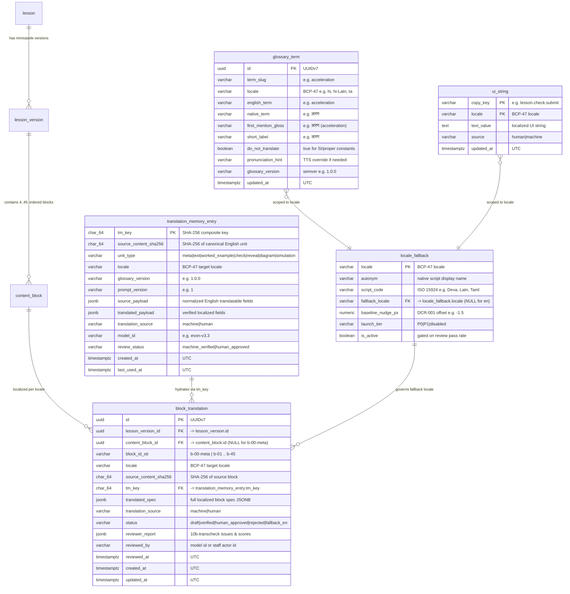

# Zivon Translation Pipeline — Architecture & Implementation Specification

- **Spec ID**: `SP2-TRANS` (Wave S1)
- **Status**: Build-ready specification for `EX2-TRANS` (factory translation stages) and `EX5-FRONT` (frontend locale switcher & localized bundles)
- **Governing ADRs**: `ADR-0004`, `ADR-0006`, `ADR-0009`, `ADR-0013`, `ADR-0015`, [`ADR-0021`](../../backend/adr/0021-translation-stage-placement-and-resumability.md), [`ADR-0022`](../../backend/adr/0022-translation-memory-and-cache-architecture.md), [`ADR-0023`](../../backend/adr/0023-physics-terminology-and-script-rendering-policy.md)
- **Product Traceability**: Features `F-WRP-TRN-01` (Localized Lesson Reading), `F-WRP-TRN-02` (In-Page Language Bar & Locale Persistence), `F-WRP-TRN-03` (Bilingual Physics Glossary & First-Mention Gloss), `F-WRP-TRN-04` (Untranslated Block Fallback & Issue Report); Tension Decisions `T2`, `T4`, `T8`; Doc Change Proposal `DCR-001`.

---

## 1. Pipeline Shape & Stage Graph (`ADR-0013`, `ADR-0021`)

### 1.1 Where Translation Runs in the Content Factory

Per `ADR-0013` and `ADR-0021`, lesson localization is a **build-time** responsibility of the content factory (`pipeline.py`), positioned **after** the English page has passed all factual, performance, and code review gates (`03-check`/`04-repair`, `07-perf`/`08-fixloop`, and `09-review`/`10-reviewfix`) and **immediately before** `11-link` publishes the staging tree into `frontend/`.

```
00-ingest → 01-locate → 02-generate → 03-check ↔ 04-repair
  → 05-interactive → 06-render (en) → 07-perf ↔ 08-fixloop → 09-review ↔ 10-reviewfix
  ┌──────────────────────────────────────────────────────────────────────────────────┐
  │ LOCALIZATION SUB-GRAPH (runs when config.translation.enabled == true)            │
  │                                                                                  │
  │  10a-translate   (per locale, per block via llm_manager -> Evon v3.3 + TM cache) │
  │        ↓                                                                         │
  │  10b-transcheck  (9 deterministic code rules + Evon v3.3 Reviewer per locale)    │
  │        ↕  (blocking fatal/major issues route to catcher; never re-runs 00..10)   │
  │  10c-transrepair (re-translates ONLY flagged (locale, block_id) items)           │
  │        ↓                                                                         │
  │  10d-transrender (writes localized HTML routes + i18n/<locale>.json + lint gate) │
  └──────────────────────────────────────────────────────────────────────────────────┘
  → 11-link (copies English + localized bundles into frontend/, updates courses.js)
```

### 1.2 Stage Registry Additions (`factory/stages.py`)

| Stage ID | Module | Model Call? | Input Artifacts | Output Artifact (`runs/<run_id>/<stage>/output.json`) |
|---|---|---|---|---|
| `10a-translate` | `factory/translate.py` | **Yes** — 1 call per cache-missed `(locale, unit_id)` via `LLMClient` → `llm-manager` (`Evon v3.3`) | `02-generate` (`ground_truth`, `lesson`), `04-repair` (or `02-generate`) `blocks`, `05-interactive` / `10-reviewfix` (`page.js` simulation strings), `sources/glossary/physics_glossary.json` | `{locales: {<loc>: {meta, blocks, sim_strings, stats}}}` + per-block checkpoints under `10a-translate/blocks/<loc>/<unit_id>.json` |
| `10b-transcheck` | `factory/transcheck.py` | **Yes + Code** — deterministic rules (`run_all_trans_rules`) + 1 bounded reviewer call per locale (`Evon v3.3`) | English `ground_truth`, `lesson`, `blocks`, plus `10a-translate` (or `10c-transrepair`) localized output | `{locales: {<loc>: {model_issues, rule_issues, blocking_count, verdict}}, verdict: "pass"\|"fail"}` |
| `10c-transrepair` | `factory/transrepair.py` | **Yes (Catcher)** — progress-aware loop; 1 call per flagged `(locale, unit_id)` per round | Flagged `issues` from `10b-transcheck`, English source unit, rejected translated unit, chapter glossary | `{locales: {<loc>: {page, history}}, rounds: N}` + updated per-block checkpoint files and `sources/cache/tm/` entries on pass |
| `10d-transrender` | `factory/render.py` (`render_localized`) | **No (Code)** — deterministic HTML/JSON rendering + `lint_generated` | `06-render`/`10-reviewfix` staging dir, verified localized outputs from `10a`/`10c`, `ui_strings.json` | `{locales: {<loc>: {topic_dir, i18n_json, lint_hits, fallback_blocks}}, manifest_updated: true}` |

### 1.3 Resumability & Fingerprint Contract

1. **Per-block checkpointing (`ADR-0021`)**:
   - The translation worklist for a topic in locale `L` consists of `1 + N` ordered units:
     - `b-00-meta`: Lesson metadata envelope (`lesson.title`, `lesson.objectives`, `lesson.sections`, `lesson.glossary`, and extracted `sim_strings` from `page.js`).
     - `b-01` .. `b-NN`: Each block in `blocks["blocks"]` (`4 <= N <= 45`).
   - Before invoking `llm.call(...)` for `(locale, unit_id)`:
     1. Compute `source_content_sha256` and `tm_key` (see §3.1).
     2. Check **In-Run Checkpoint**: `runs/<run_id>/10a-translate/blocks/<locale>/<unit_id>.json`. If the file exists, parses cleanly, validates against `TRANSLATED_BLOCK_RESPONSE`, and its recorded `tm_key` equals the current `tm_key`, load it immediately (`status = "resumed_in_run"`).
     3. Check **Cross-Run Translation Memory (TM)**: `sources/cache/tm/<locale>/<tm_key[:2]>/<tm_key>.json` (Tier 1 PVC cache) or PostgreSQL `translation_memory_entry` (Tier 2 when `ZIVON_DB_URL` is configured). If a verified entry matches `tm_key`, copy it to `runs/<run_id>/10a-translate/blocks/<locale>/<unit_id>.json` (`status = "tm_hit"`).
     4. Otherwise, call `LLMClient.call(stage_id="10a-translate", round_tag=f"{locale}/{unit_id}", ...)` through `llm_manager` (`run_validation_rounds` with `extra_validator=validate_translated_unit_rules`). Write the validated output atomically (`<unit_id>.json.tmp` → `os.replace` → `<unit_id>.json`).
2. **Stage-level resume**:
   - Once all units for all target locales complete in `10a-translate`, `run_ctx.save_stage_output("10a-translate", ...)` and `run_ctx.mark_stage("10a-translate", "ok")` execute.
   - If the pod dies during `10b-transcheck` or `10c-transrepair`, re-triggering `scripts/trigger-factory-run.sh "<chapter>" <class>` skips `00-ingest`..`10a-translate` and resumes directly at `10b-transcheck` (picking up any repaired blocks from `10c-transrepair` exactly as `03-check`/`04-repair` do in `factory/stages.py:315`).
3. **Fingerprint backward compatibility**:
   - In `config.json`, `translation` is a top-level section (and `repair` adds `translation_rounds`):
```json
{
  "translation": {
    "enabled": false,
    "target_locales": ["hi", "hi-Latn"],
    "optional_locales": [],
    "glossary_path": "sources/glossary/physics_glossary.json",
    "ui_strings_path": "sources/glossary/ui_strings.json",
    "prompt_version": "1",
    "max_chars_neighbour_context": 600
  },
  "repair": {
    "translation_rounds": 6
  }
}
```
   - In `config.json`, `repair` adds `"translation_rounds": 6` (range `1..20`).
   - When `translation.enabled` is `false`, `run_fingerprint()` omits the `translation` payload so existing `PIPELINE_VERSION = "7"` run directories remain 100% resumable without `--fresh`. When `translation.enabled` is `true`, `translation` (`target_locales`, `prompt_version`, `glossary_sha256`) is mixed into `run_fingerprint()`.

---

## 2. Block-by-Block Translation Strategy (`ADR-0023`, `ADR-0009`)

### 2.1 Language & Locale Model (`ADR-0009`)

Per `ADR-0009` and `docs/frontend/design-doctrine.md` §10.5, every locale has a stable BCP-47 identifier, native autonym (never displayed solely in English), script tag, wave priority, and `DCR-001` baseline offset:

| Locale Code (`BCP-47`) | Autonym (Chip Label) | English Name | Script (`ISO 15924`) | Dir | Wave / Priority | Font Stack (`zivon.css`) | `DCR-001` `--script-baseline-nudge` |
|---|---|---|---|---|---|---|---|
| `en` | `English` | English (Source) | `Latn` | `ltr` | **P0 (Built)** | `Courier Prime` (body), `Caveat` (accents), `Bricolage Grotesque` (UI) | `0px` |
| `hi` | `हिन्दी` | Hindi | `Deva` | `ltr` | **P0 (Wave 1)** | `Noto Sans Devanagari`, `Nirmala UI`, `Mangal` (body); `Kalam`, `Caveat` (accents) | `-1.5px` |
| `hi-Latn` | `Hinglish` | Hinglish (Hindi in Latin script) | `Latn` | `ltr` | **P0 (Wave 1)** | Same as `en` (`Courier Prime` / `Caveat` / `Bricolage Grotesque`) | `0px` |
| `ta` | `தமிழ்` | Tamil | `Taml` | `ltr` | **P1 (Post-Challenge)** | `Noto Sans Tamil`, `Nirmala UI`, `Latha`, sans-serif | `-1.0px` |
| `te` | `తెలుగు` | Telugu | `Telu` | `ltr` | **P1 (Post-Challenge)** | `Noto Sans Telugu`, `Nirmala UI`, `Gautami`, sans-serif | `-2.0px` |
| `mr` | `मराठी` | Marathi | `Deva` | `ltr` | **P1 (Post-Challenge)** | Same as `hi` (`Deva`) | `-1.5px` |
| `bn` | `বাংলা` | Bengali | `Beng` | `ltr` | **P1 (Post-Challenge)** | `Noto Sans Bengali`, `Nirmala UI`, `Vrinda`, sans-serif | `-1.0px` |
| `gu` | `ગુજરાતી` | Gujarati | `Gujr` | `ltr` | **P1 (Post-Challenge)** | `Noto Sans Gujarati`, `Nirmala UI`, `Shruti`, sans-serif | `-1.0px` |
| `kn` | `ಕನ್ನಡ` | Kannada | `Knda` | `ltr` | **P1 (Post-Challenge)** | `Noto Sans Kannada`, `Nirmala UI`, `Tunga`, sans-serif | `-2.0px` |
| `ml` | `മലയാളം` | Malayalam | `Mlym` | `ltr` | **P1 (Post-Challenge)** | `Noto Sans Malayalam`, `Nirmala UI`, `Kartika`, sans-serif | `-2.0px` |
| `pa` | `ਪੰਜਾਬੀ` | Punjabi (Gurmukhi) | `Guru` | `ltr` | **P1 (Post-Challenge)** | `Noto Sans Gurmukhi`, `Nirmala UI`, `Raavi`, sans-serif | `-1.0px` |
| `ur` | `اردو` | Urdu (RTL) | `Arab` | `rtl` | **Explicitly Out of Scope** (`T2`/`05` §2.2) | Out of scope for v1/P1 (requires RTL layout mirroring of taped cards, pen underlines, and `LessonKit`) | n/a |

### 2.2 Per-Block Translation Rules & Field Matrix

Every block preserves its outer envelope (`id`, `type`, `citations`) untouched. Only human-readable string fields inside `spec` are translated, governed by the per-type rules below (exact JSON schemas in [`block-contract.md`](block-contract.md)):

| Unit / Block Type | Translatable Fields | Immutable Fields (Copied by Code, Never by LLM) | Special Strategy & Expansion Budget |
|---|---|---|---|
| `b-00-meta` (`lesson` + `sim_strings`) | `title`, `objectives[]`, `sections[].title`, `sections[].paragraphs[]`, `glossary[].term`, `glossary[].definition`, `sim_strings.<block_id>.<key>` | `sections[].id` (`^sec-[0-9]{2}$`), `sim_strings` keys & numeric placeholders (`{0}`, `{val}`) | Establishes chapter-level terminology; `glossary[].term` uses `<Native Term> (<English Term>)` in Indic scripts and `<English Term> (<Roman Hindi>)` in `hi-Latn`. Title budget: `<= 1.35x` chars. |
| `text` | `spec.paragraphs[]` | `id`, `type`, `citations` | First mention of any chapter glossary term in the block uses `<Native Term> (<English Term>)`. Preserve inline equations (`v = u + at`), SI units (`m/s²`), and numerals (`0–9`) verbatim. Budget: `<= 1.50x` chars. |
| `worked_example` | `spec.problem`, `spec.steps[].title`, `spec.steps[].detail`, prose portion of `spec.answer` | `id`, `type`, `citations`, **all numerals** in `spec.problem` and `spec.answer`, all equations & SI units | **Critical invariant**: `factory/checks.py::rule_numbers` requires every numeral in `spec.problem` to appear verbatim in the source corpus. Code pre-extracts numerals from English `spec.problem` and asserts 100% multiset equality in the translated `spec.problem`. |
| `check` (`format: "mcq"`) | `spec.question`, `spec.options[]` (same length & order), `spec.explanation`, `spec.expected_understanding` | `id`, `type`, `citations`, `spec.format` (`"mcq"`), `spec.answer_index` (`0..3`), all numerals in `spec.question` and `spec.options[answer_index]` | **Answer-key lock**: The model translates `options[]` in place (indices `0..3` never reorder). Harness code sets `translated_spec["answer"] = translated_spec["options"][spec["answer_index"]]` deterministically so `rule_answer_keys` can never fail due to whitespace/string drift between `answer` and `options[answer_index]`. |
| `check` (`format: "numeric"`) | `spec.question`, `spec.explanation`, `spec.expected_understanding` | `id`, `type`, `citations`, `spec.format` (`"numeric"`), **`spec.answer`** (copied verbatim from English by code), all numerals in `spec.question` | `spec.answer` is a pure numeric string (e.g. `"3.06"`) graded by `zivon.js::firstNumber`; the LLM is not even allowed to emit `spec.answer` for `numeric` checks — harness code copies it verbatim. |
| `reveal` | `spec.title`, `spec.steps[].title`, `spec.steps[].detail` | `id`, `type`, `citations` | Rendered as `<details class="zn-reveal-step">`. `spec.title` and `steps[].title` budget: `<= 1.35x` chars; `detail` budget: `<= 1.50x` chars. |
| `diagram` | `spec.caption`, plus extracted SVG text table `svg_texts[]` (`<text>` node strings and root `<svg aria-label>`) | `id`, `type`, `citations`, **entire `<svg>` markup structure, tags, coordinates, `viewBox`, paths, strokes, colours** | **SVG Extraction/Re-injection Protocol**: The LLM **never** receives or emits raw `<svg>` markup. Before calling `llm_manager`, `factory/translate.py` parses `spec.svg` via `xml.etree.ElementTree`, extracts only non-symbol `<text>` character data and `aria-label` into `svg_texts: [{"id": "t-0", "source": "Slope = acceleration"}]` (skipping pure math/symbol nodes like `v`, `t`, `0`, `10 N`, `m₁`). The LLM translates only `svg_texts` and `caption` (`<= 1.25x` or `+6` chars per label). Code re-injects the translated strings into the original SVG DOM and runs `rule_diagram_svg`. |
| `simulation` | `spec.title`, `spec.description`, `spec.learning_goal`, `spec.controls[].label`, `spec.default_behaviour` | `id`, `type`, `citations`, `spec.controls[].id`, `min`, `max`, `step`, `initial`, `page.js` code | `spec.controls[].label` has a hard budget of **<= 32 characters** (e.g., `त्वरण a (m/s²)` or `Raftar v (m/s)`) so mobile slider rows never overflow. Canvas text strings in `page.js` are localized via the `window.ZIVON_SIM_I18N` dictionary emitted from `b-00-meta.sim_strings` (see §5.2). |

### 2.3 Context-Window & Chunk-Size Rules

To prevent context bloat and thinking-token runaway (which caused 09-review stalls prior to the 2026-11-08 split in `docs/content-factory/architecture.md`):
- **One block per model call**: Each `10a-translate` call translates **at most 1 unit** (`b-00-meta` or one `b-NN` block).
- **Bounded surrounding context (`<= 600 chars`)**: Each per-block prompt includes:
  1. Target locale descriptor (`locale`, `autonym`, `script`, script rules per `ADR-0023`).
  2. Filtered **Chapter Glossary Subset**: Only the glossary terms (from `sources/glossary/physics_glossary.json` + `b-00-meta` translated `lesson.glossary`) whose English term appears (case-insensitive stem match) in the current block's text (~3–12 terms, `< 800 chars`).
  3. **Neighbour Context Window**: Read-only 1-sentence / 300-char excerpt of `b-(k-1)` (already translated in target locale, for terminology/pronoun continuity) and `b-(k+1)` (English source, for forward context), capped at `config.translation.max_chars_neighbour_context = 600` chars total.
  4. The current block's translatable JSON payload + target JSON schema contract.
- **Total prompt size per block**: `~1,200–3,200` tokens (`~4–11 KB`), producing `~150–800` completion tokens (excluding `b-00-meta` which is `~2,500` prompt tokens and `~800–1,500` completion tokens). This is `< 3%` of Evon v3.3's `128K` context window.

---

## 3. Translation Memory, Database Schema & Storage Tiering (`ADR-0022`, `ADR-0004`, `ADR-0006`)

### 3.1 Deterministic Canonical Hash (`canonical_block_hash`)

To key Translation Memory identically across Phase A (PVC files) and Phase B/C (PostgreSQL):

```python
def extract_translatable_payload(unit_id: str, block_or_meta: dict[str, Any]) -> dict[str, Any]:
    """Return ONLY the fields whose change requires re-translation.
    Excludes citations, numeric control bounds (min/max/step/initial),
    check numeric answers, and raw SVG geometry (includes only extracted svg_texts)."""
    ...

def compute_tm_keys(
    unit_id: str,
    translatable_payload: dict[str, Any],
    target_locale: str,
    glossary_version: str,
    prompt_version: str,
) -> tuple[str, str]:
    normalized = unicodedata.normalize(
        "NFC",
        json.dumps(translatable_payload, sort_keys=True, ensure_ascii=False, separators=(",", ":")),
    )
    source_content_sha256 = hashlib.sha256(normalized.encode("utf-8")).hexdigest()
    composite = f"{source_content_sha256}:{target_locale}:{glossary_version}:{prompt_version}"
    tm_key = hashlib.sha256(composite.encode("utf-8")).hexdigest()
    return source_content_sha256, tm_key
```

### 3.2 Database Entities & Traceability (`docs/backend/db-spec.md` Conventions)

All tables below belong to **Data Class `C3` (Translations & glossaries)** in PostgreSQL (`skills/zivon-systems-design-skills/skills/zivon-systems-design/references/02-data-classification-and-tiering.md` §2 and `03-database-spec-method.md` §3). None store child or personal data (`pii_class = none`, `retention = content-life`).

#### Entity Traceability Summary

| Table Name | Data Class | System of Record | Traces to `ENT?` / `INF` | Serves `NEED` / `F-*` |
|---|---|---|---|---|
| `glossary_term` | `C3` | PostgreSQL (seeded from `sources/glossary/physics_glossary.json`) | `ENT?-GlossaryTerm`, `INF-014` (glossary term & gloss) | `NEED-TRN-02`, `F-WRP-TRN-03` |
| `translation_memory_entry` | `C3` | PostgreSQL + `sources/cache/tm/` PVC mirror | `ENT?-TranslationMemory`, systems-originated (`ADR-0022`) | `NEED-TRN-01`, `NFR-TRN-04` |
| `block_translation` | `C3` | PostgreSQL (compiled into `C1` bundle at publish) | `ENT?-BlockTranslation`, `INF-011`..`INF-016` | `NEED-TRN-01`, `F-WRP-TRN-01`, `F-WRP-TRN-04` |
| `ui_string` | `C3` | PostgreSQL (seeded from `sources/glossary/ui_strings.json`) | `ENT?-UIString`, `INF-009` (localized UI chrome) | `NEED-TRN-03`, `F-WRP-TRN-02` |
| `locale_fallback` | `C3` | PostgreSQL (seeded reference data) | `ENT?-LocaleFallback`, `INF-010` (fallback notice) | `NEED-TRN-03`, `F-WRP-TRN-04` |

#### ER Diagram (Mermaid)



#### Per-Table Column Specifications

##### Table 1: `glossary_term` (Data Class `C3`)
- **Purpose**: Canonical Class 9–12 Physics terminology table ensuring consistent bilingual first-mention glosses (`ADR-0023`) across all chapters and blocks.
- **Keys & Constraints**:
  - `PRIMARY KEY (id)` (`UUIDv7`)
  - `UNIQUE (term_slug, locale, glossary_version)`
  - `CHECK (locale ~ '^[a-z]{2,3}(-[A-Za-z]{2,4})?$')`
- **Indexes**:
  - `idx_glossary_term_locale_ver ON glossary_term (locale, glossary_version)` — serves `NEED-TRN-02` (load active glossary per locale at `10a-translate` startup, `< 5 ms`).
- **Columns**:

| Column | Type | Null | Default | Source (`INF`/`ENT?`) | PII Class | Retention |
|---|---|---|---|---|---|---|
| `id` | `uuid` | `NOT NULL` | `uuidv7()` | systems-originated | `none` | `content-life` |
| `term_slug` | `varchar(64)` | `NOT NULL` | — | `ENT?-GlossaryTerm.slug` | `none` | `content-life` |
| `locale` | `varchar(16)` | `NOT NULL` | — | `ENT?-GlossaryTerm.locale` | `none` | `content-life` |
| `english_term` | `varchar(128)` | `NOT NULL` | — | `INF-014` | `none` | `content-life` |
| `native_term` | `varchar(128)` | `NOT NULL` | — | `INF-014` | `none` | `content-life` |
| `first_mention_gloss` | `varchar(256)` | `NOT NULL` | — | `INF-014` (`ADR-0023`) | `none` | `content-life` |
| `short_label` | `varchar(64)` | `NOT NULL` | — | `INF-015` (sim/diagram label) | `none` | `content-life` |
| `do_not_translate` | `boolean` | `NOT NULL` | `false` | `ENT?-GlossaryTerm.dnt` | `none` | `content-life` |
| `pronunciation_hint` | `varchar(256)` | `NULL` | `NULL` | `INF-018` (TTS override) | `none` | `content-life` |
| `glossary_version` | `varchar(16)` | `NOT NULL` | `'1.0.0'` | systems-originated | `none` | `content-life` |
| `updated_at` | `timestamptz` | `NOT NULL` | `now()` | systems-originated | `none` | `content-life` |

##### Table 2: `translation_memory_entry` (Data Class `C3`)
- **Purpose**: Deduplicated cross-run and cross-version translation cache keyed by `tm_key` (`ADR-0022`). Mirrored to `sources/cache/tm/<locale>/<tm_key[:2]>/<tm_key>.json` on the `zivon-sources` PVC.
- **Keys & Constraints**:
  - `PRIMARY KEY (tm_key)` (`char(64)`)
  - `UNIQUE (source_content_sha256, locale, glossary_version, prompt_version)`
  - `CHECK (translation_source IN ('machine', 'human'))`
  - `CHECK (review_status IN ('machine_verified', 'human_approved'))`
- **Indexes**:
  - `idx_tm_source_sha_locale ON translation_memory_entry (source_content_sha256, locale)` — serves lookup of human-approved overrides when `glossary_version` or `prompt_version` bumps (`NEED-TRN-01`, `< 2 ms`).
- **Columns**:

| Column | Type | Null | Default | Source (`INF`/`ENT?`) | PII Class | Retention |
|---|---|---|---|---|---|---|
| `tm_key` | `char(64)` | `NOT NULL` | — | systems-originated (`ADR-0022`) | `none` | `content-life` |
| `source_content_sha256` | `char(64)` | `NOT NULL` | — | systems-originated | `none` | `content-life` |
| `unit_type` | `varchar(24)` | `NOT NULL` | — | `ENT?-BlockTranslation.type` | `none` | `content-life` |
| `locale` | `varchar(16)` | `NOT NULL` | — | `ENT?-BlockTranslation.locale` | `none` | `content-life` |
| `glossary_version` | `varchar(16)` | `NOT NULL` | — | systems-originated | `none` | `content-life` |
| `prompt_version` | `varchar(16)` | `NOT NULL` | — | systems-originated | `none` | `content-life` |
| `source_payload` | `jsonb` | `NOT NULL` | — | `ENT?-ContentBlock.spec` | `none` | `content-life` |
| `translated_payload` | `jsonb` | `NOT NULL` | — | `ENT?-BlockTranslation.spec` | `none` | `content-life` |
| `translation_source` | `varchar(16)` | `NOT NULL` | `'machine'` | `INF-016` (provenance) | `none` | `content-life` |
| `model_id` | `varchar(64)` | `NOT NULL` | `'evon-v3.3'` | systems-originated | `none` | `content-life` |
| `review_status` | `varchar(24)` | `NOT NULL` | `'machine_verified'` | `INF-016` | `none` | `content-life` |
| `created_at` | `timestamptz` | `NOT NULL` | `now()` | systems-originated | `none` | `content-life` |
| `last_used_at` | `timestamptz` | `NOT NULL` | `now()` | systems-originated | `none` | `content-life` |

##### Table 3: `block_translation` (Data Class `C3`)
- **Purpose**: Per-lesson-version localized block record linking `lesson_version` and `content_block` to its verified localized `spec` and reviewer audit trail (`03-database-spec-method.md` §3).
- **Keys & Constraints**:
  - `PRIMARY KEY (id)` (`UUIDv7`)
  - `UNIQUE (lesson_version_id, block_id_str, locale)`
  - `FOREIGN KEY (lesson_version_id) REFERENCES lesson_version(id) ON DELETE RESTRICT`
  - `FOREIGN KEY (content_block_id) REFERENCES content_block(id) ON DELETE RESTRICT`
  - `FOREIGN KEY (tm_key) REFERENCES translation_memory_entry(tm_key) ON DELETE SET NULL`
  - `CHECK (status IN ('draft', 'verified', 'human_approved', 'rejected', 'fallback_en'))`
  - `CHECK (translation_source IN ('machine', 'human'))`
- **Indexes**:
  - `idx_block_trans_version_locale ON block_translation (lesson_version_id, locale, status)` — serves bundle assembly at `10d-transrender` / `11-link` (`NEED-TRN-01`, `< 10 ms`).
- **Columns**:

| Column | Type | Null | Default | Source (`INF`/`ENT?`) | PII Class | Retention |
|---|---|---|---|---|---|---|
| `id` | `uuid` | `NOT NULL` | `uuidv7()` | systems-originated | `none` | `content-life` |
| `lesson_version_id` | `uuid` | `NOT NULL` | — | `ENT?-LessonVersion.id` | `none` | `content-life` |
| `content_block_id` | `uuid` | `NULL` | `NULL` | `ENT?-ContentBlock.id` (`NULL` for `b-00-meta`) | `none` | `content-life` |
| `block_id_str` | `varchar(16)` | `NOT NULL` | — | `ENT?-ContentBlock.block_id` (`b-00-meta` \| `b-01`..`b-45`) | `none` | `content-life` |
| `locale` | `varchar(16)` | `NOT NULL` | — | `INF-008`, `ENT?-BlockTranslation.locale` | `none` | `content-life` |
| `source_content_sha256` | `char(64)` | `NOT NULL` | — | systems-originated | `none` | `content-life` |
| `tm_key` | `char(64)` | `NULL` | `NULL` | systems-originated (`ADR-0022`) | `none` | `content-life` |
| `translated_spec` | `jsonb` | `NOT NULL` | — | `INF-011`..`INF-015`, `ENT?-BlockTranslation.spec` | `none` | `content-life` |
| `translation_source` | `varchar(16)` | `NOT NULL` | `'machine'` | `INF-016` (machine vs human badge) | `none` | `content-life` |
| `status` | `varchar(24)` | `NOT NULL` | `'draft'` | `INF-010`, `ENT?-BlockTranslation.status` | `none` | `content-life` |
| `reviewer_report` | `jsonb` | `NULL` | `NULL` | systems-originated (`10b-transcheck` report) | `none` | `content-life` |
| `reviewed_by` | `varchar(64)` | `NULL` | `NULL` | `ENT?-BlockTranslation.reviewed_by` | `none` | `content-life` |
| `reviewed_at` | `timestamptz` | `NULL` | `NULL` | `ENT?-BlockTranslation.reviewed_at` | `none` | `content-life` |
| `created_at` | `timestamptz` | `NOT NULL` | `now()` | systems-originated | `none` | `content-life` |
| `updated_at` | `timestamptz` | `NOT NULL` | `now()` | systems-originated | `none` | `content-life` |

##### Table 4: `ui_string` & Table 5: `locale_fallback` (Data Class `C3`)
- `ui_string(copy_key VARCHAR(128), locale VARCHAR(16), text_value TEXT NOT NULL, source VARCHAR(16) NOT NULL DEFAULT 'human', updated_at TIMESTAMPTZ NOT NULL DEFAULT now(), PRIMARY KEY (copy_key, locale))` — stores static shell copy keys (`lesson.lang.label`, `lesson.objectives.heading`, `lesson.example.heading`, `lesson.answer.label`, `lesson.check.submit`, `lesson.check.why`, `lesson.check.pick_first`, `lesson.check.correct`, `lesson.check.wrong`, `lesson.glossary.heading`, `lesson.sources.footer`, `lesson.untranslated.block_notice`, `lesson.untranslated.page_notice`, `lesson.report.translation_issue`).
- `locale_fallback(locale VARCHAR(16) PRIMARY KEY, autonym VARCHAR(64) NOT NULL, script_code CHAR(4) NOT NULL, fallback_locale VARCHAR(16) REFERENCES locale_fallback(locale), baseline_nudge_px NUMERIC(4,2) NOT NULL DEFAULT 0.0, launch_tier VARCHAR(16) NOT NULL, is_active BOOLEAN NOT NULL DEFAULT false)` — seeded with:
  - `en` (`fallback_locale = NULL`, `baseline_nudge_px = 0.00`, `launch_tier = 'P0'`, `is_active = true`)
  - `hi` (`fallback_locale = 'en'`, `baseline_nudge_px = -1.50`, `launch_tier = 'P0'`, `is_active = true`)
  - `hi-Latn` (`fallback_locale = 'hi'`, `baseline_nudge_px = 0.00`, `launch_tier = 'P0'`, `is_active = true`)
  - `ta`, `te`, `mr`, `bn`, `gu`, `kn`, `ml`, `pa` (`fallback_locale = 'en'`, `launch_tier = 'P1'`, `is_active = false` until language review gate passes).

### 3.3 Storage Tiering, Sync Policy & "Pull the Plug" Test (`storage-tiering.md` & `sync-policy.csv`)

Per `docs/backend/storage-tiering.md` and `docs/backend/sync-policy.csv` (`02-data-classification-and-tiering.md` §2–§3), the exact 12-column `sync-policy.csv` rows governing translation artifacts are:

```csv
rule_id,class_id,trigger,mechanism,idempotency_key,verification,on_failure,retry_policy,slo,alert,runbook,phase
SYNC-01,C1,on publish (11-link / publish-frontend.sh),outbox->worker->multipart upload of localized bundle,sha256,read-back checksum + object.cold_verified_at update,hold live_pointer(lesson_id locale) flag,exp backoff max 24h,99% verified in 5min,backlog age>15min,RB-04,B
SYNC-02,C3,WAL segment close (60s) + daily 02:30 IST base backup,wal-g wal-push + pg_basebackup + tm/ tarball sync,wal_lsn_sha256,pg_verifybackup + weekly checksum scrub (SYNC-06),alert + pause SSD cache eviction,continuous retry backoff max 15m,RPO<=5min RTO<=4h,wal archive lag>5min,RB-02,B
SYNC-03,C4,run completes + 24h settle delay,nightly batch compress (tar.zst) -> cold upload,run_id_sha256,read-back checksum + manifest row in object table,retain hot run dir on zivon-sources PVC,exp backoff 3x nightly,99% archived in 48h,unarchived runs>10,RB-05,B
```

Summary by storage tier:

| Sync Rule ID | Data Class | Artifact / Table | Hot on SSD | Cold Storage (Separate Provider per `ADR-0004`) | Trigger & Mechanism | Verification & Eviction Invariant |
|---|---|---|---|---|---|---|
| `SYNC-01` | `C1` (Published lesson bundles) | `frontend/courses/<course>/<slug>/<locale>/index.html`, `i18n/<locale>.json`, `manifest.json` | `zivon-frontend` PVC + repo `frontend/` git snapshot | Object key `c1/{topic}/{class}/{locale}/{version}/{sha256}.tar.zst` | **On publish (`11-link` / `publish-frontend.sh`)**: transactional outbox job uploads bundle to cold store | Read-back SHA-256 matched → `object.cold_verified_at` set → only then `live_pointer(lesson_id, locale)` flips live. LRU eviction from SSD permitted only when `cold_verified_at IS NOT NULL` and not pinned. |
| `SYNC-02` | `C3` (Translations & glossaries) | PostgreSQL `glossary_term`, `translation_memory_entry`, `block_translation`, `ui_string`, `locale_fallback` + `sources/cache/tm/` PVC | Postgres NVMe volume + `zivon-sources` PVC (`sources/cache/tm/`) | Continuous WAL archive (`wal-g wal-push`, `archive_timeout = 60s`) + nightly base backup (`02:30 IST`) + nightly `tm/` tarball sync | **Continuous WAL + nightly base backup** (`ADR-0006`) | `pg_verifybackup` + weekly checksum scrub (`SYNC-06`) + monthly restore drill. RPO <= 5 min, RTO <= 4 h. |
| `SYNC-03` | `C4` (Content-factory run evidence) | `runs/<run_id>/10a-translate/`, `10b-transcheck/`, `10c-transrepair/`, `10d-transrender/` | `zivon-sources` PVC (`subPath: runs`) during active run + last `N = 10` runs | `c4/{run_id}/{completed_date}/translation-evidence.tar.zst` | **Run completes + 24 h settle delay** (nightly batch worker) | Verify archive SHA-256 and manifest row in `object` table before removing old run dir from `zivon-sources` PVC. |

#### "Pull the Plug" Test for Translation Data Classes

1. **SSD (`zivon-sources` or `zivon-frontend` PVC) destroyed right now**:
   - *Published localized lessons (`C1`)*: Zero data loss (`RPO = 0`). Restored from the git-versioned `frontend/` snapshot (Phase A) or cold storage `c1/...` bundles (Phase B) in `< 10 min` (`RTO`). Students see no interruption if CDN/second pod is warm, or brief static re-seed.
   - *Translation Memory & DB rows (`C3`)*: Restored from PostgreSQL base backup + WAL replay (`RPO <= 5 min`, `RTO <= 1 h` for DB) and re-hydrated into `sources/cache/tm/`. At most the last 5 minutes of un-archived build-time translations would need re-translation by Evon v3.3.
2. **Cold storage provider (`ADR-0004`) unreachable right now**:
   - Serving of all live localized lessons (`en`, `hi`, `hi-Latn`) continues 100% unaffected from `zivon-frontend` PVC / nginx.
   - New factory runs continue using the local `zivon-sources` PVC TM cache; `SYNC-01` cold-upload jobs queue in the DB outbox and SSD eviction is paused until cold connectivity returns.
3. **Child/guardian deletion request right now**:
   - `C1` and `C3` contain **zero** personal or child data (`pii_class = none`, curriculum text only). Only `C8` (`device_profile` / `preference` language choice) and `C6` (session transcripts) are subject-linked and purged by `subject_ref`.

---

## 4. Quality Gate: Deterministic Rules + LLM Translation Reviewer (`10b-transcheck` & `10c-transrepair`)

Full rubric, prompt template, and deterministic check algorithms are specified in [`reviewer-rubric.md`](reviewer-rubric.md). In summary:

1. **Layer 1 — Deterministic Code Checks (`factory/transcheck.py`, runs in `< 50 ms` before any reviewer LLM call)**:
   - `rule_trans_schema`: Validates every translated unit against `TRANSLATED_BLOCK_RESPONSE` (`block-contract.md`).
   - `rule_trans_citations`: Asserts `translated_block["citations"] == source_block["citations"]` (exact equality; zero lost or invented citations).
   - `rule_trans_numbers`: Extracts all Western Arabic numerals (`\d+(?:\.\d+)?`) from `worked_example.spec.problem`, `check.spec.question`, and `check.spec.options[answer_index]`; asserts exact multiset preservation in the translated text and **zero** regional Unicode digits (`[\u0966-\u096F\u0BE6-\u0BEF\u0C66-\u0C6F\u09E6-\u09EF\u0AE6-\u0AEF\u0CE6-\u0CEF\u0D66-\u0D6F\u0A66-\u0A6F]`).
   - `rule_trans_units_and_symbols`: Asserts that equation strings (`v = u + at`) and SI unit tokens (`m/s`, `m/s²`, `kg`, `N`, `J`, `W`, `Hz`, `Pa`, `Ω`) present in the source block remain intact.
   - `rule_trans_mcq_integrity`: Asserts `len(translated_options) == len(source_options)`, `answer_index` unchanged, and `translated_spec["answer"] == translated_options[answer_index]`; for `numeric` checks, asserts `translated_spec["answer"] == source_spec["answer"]`.
   - `rule_trans_script_purity`: For `hi-Latn` (Hinglish), rejects any Devanagari character (`[\u0900-\u097F]`) as `fatal`. For native-script locales (`hi`, `ta`, etc.), requires native script characters to comprise `>= 40%` of alphabetic characters in prose blocks (catching lazy untranslated English echoes).
   - `rule_trans_placeholders`: Rejects untranslated template markers (`TODO`, `TBD`, `[translate]`, `{{`, `}}`, `<TRANSLATE>`, `...` truncation when not in source, or mismatched `{0}` / `{val}` placeholders in `sim_strings`).
   - `rule_trans_svg_safety`: Verifies that the re-injected diagram `<svg>` has identical element tree structure, tag count, and non-text attributes as the English `<svg>`, and passes `factory/checks.py::rule_diagram_svg`.
   - `rule_trans_length_budget`: Enforces surface expansion caps (`controls[].label <= 32 chars`, `svg_texts <= 1.25x` or `+6 chars`, prose `<= 1.50x`).
2. **Layer 2 — Calibrated LLM Judge (`10b-transcheck`, 1 bounded call per locale via `llm_manager`)**:
   - Inspects the paired `(source_unit, translated_unit)` list and chapter glossary for the locale.
   - Outputs **issues only** (`REVIEW_CALL_REPORT` schema with `TRANSLATION_REVIEW_CATEGORIES`: `physics_meaning`, `glossary_term`, `untranslated_leak`, `hallucinated_content`, `grade_register`, `awkward_phrasing`).
   - Harness code computes `verdict = "fail"` iff any issue (from code rules or LLM judge) has `severity in ("fatal", "major")`. Unverifiable stylistic preferences must use the `unverified:` `minor` escape hatch (`skills/prompting-and-agent-design/SKILL.md`).
3. **Layer 3 — Bounded Progress-Aware Repair Catcher (`10c-transrepair`)**:
   - Mirrors `04-repair` (`factory/stages.py:325`): computes `_severity_score(blocking_issues)` (`fatal=2, major=1`), re-translates **only** the flagged `block_id`s in that locale with the exact issues fed back, re-merges by `block_id`, and re-runs `10b-transcheck`.
   - Continues while the blocking score improves; stops at `stall_rounds = 3` consecutive non-improving rounds or `repair.translation_rounds = 6`. Never re-runs upstream stages (`00`..`10`).

---

## 5. Publishing, Routes & Frontend Locale Switcher Contract (`F-WRP-TRN-01`..`04`)

### 5.1 Static File Layout & URL Routing (`10d-transrender` & `11-link`)

To satisfy both **SEO indexability** (`skills/zivon-frontend-skills/seo-optimization.md`: static indexable HTML per locale with `<link rel="canonical">` and `<link rel="alternate" hreflang="...">`) and **instant zero-reload in-page switching** on low-end Android (preserving simulation canvas state and quiz selections when a student taps `हिन्दी` or `Hinglish` mid-lesson):

```
frontend/
├── index.html                                         # English course hub (lang="en")
├── hi/
│   └── index.html                                     # Hindi course hub (lang="hi")
├── hi-Latn/
│   └── index.html                                     # Hinglish course hub (lang="hi-Latn")
├── courses.js                                         # Global course index (includes locales_available + titles_by_locale)
└── courses/
    └── class-11-physics/
        └── motion-in-a-straight-line/
            ├── index.html                             # Canonical English lesson page (lang="en")
            ├── page.js                                # Model-built ZivonSim registrations (shared across locales)
            ├── page.css                               # Scoped .zn-sim-<id> styles (shared across locales)
            ├── manifest.json                          # Extended with locales_available, translation_status, i18n hashes
            ├── i18n/
            │   ├── en.json                            # English string map ( enables instant switch back to en )
            │   ├── hi.json                            # Verified Hindi string map (blocks + meta + ui_strings + sim_strings)
            │   └── hi-Latn.json                       # Verified Hinglish string map
            ├── hi/
            │   └── index.html                         # Pre-rendered Hindi lesson page (lang="hi", loads ../page.js, ../page.css, ../../../assets/*)
            └── hi-Latn/
                └── index.html                         # Pre-rendered Hinglish lesson page (lang="hi-Latn", loads ../page.js, ../page.css)
```

Why **both** pre-rendered `<locale>/index.html` AND `i18n/<locale>.json`?
1. **Offline / `file://` / strict CSP compatibility**: Look at `factory/render.py:32`:
   `CSP = "default-src 'none'; style-src 'self'; script-src 'self'; img-src 'self' data:; font-src 'self'; connect-src 'none'; base-uri 'none'"`
   Because `connect-src 'none'` is a hard security lint rule (`factory/lint.py`), lesson pages **cannot use `fetch()`** to load JSON over XHR!
   Therefore:
   - Each pre-rendered `<locale>/index.html` works with **zero network fetches** and is directly linkable/crawlable at `/courses/<course_id>/<slug>/<locale>/index.html`.
   - For instant in-page switching without losing simulation slider state or triggering a network request under `connect-src 'none'`, `10d-transrender` emits `<script src="i18n.js"></script>` (or `../i18n.js` in `<locale>/index.html`), which sets `window.ZIVON_I18N = { "en": {...}, "hi": {...}, "hi-Latn": {...} };` via `<script src="...">'self'`, completely obeying `script-src 'self'; connect-src 'none'`! (`i18n/<locale>.json` is also written alongside for build tooling and backend inspection.)

### 5.2 Locale Switcher Contract (`.zn-lang-bar` in `render.py` & `frontend/assets/zivon.js`)

Traces to `docs/frontend/design-doctrine.md` §10.5 and `docs/product/features.md` (`F-WRP-TRN-02`, `EL-LES-01-001`..`005`, `INF-008`..`INF-016`):

1. **HTML Markup Emitted by `render.py`**:
   ```html
   <header class="zn-lang-bar" data-current-locale="en">
     <div class="zn-lang-in">
       <span class="zn-lang-lab" data-i18n="ui.lang_label">Language</span>
       <div class="zn-lang-row" role="radiogroup" aria-label="Language">
         <button type="button" class="zn-chip" role="radio"
                 data-locale="en" data-href="index.html" aria-checked="true">English</button>
         <button type="button" class="zn-chip" role="radio"
                 data-locale="hi" data-href="hi/index.html" aria-checked="false" lang="hi">हिन्दी</button>
         <button type="button" class="zn-chip" role="radio"
                 data-locale="hi-Latn" data-href="hi-Latn/index.html" aria-checked="false">Hinglish</button>
       </div>
       <span class="zn-trans-badge" data-i18n="ui.trans_badge" hidden>AI-translated · Reviewed</span>
     </div>
   </header>
   ```
   - When `>= 5` locales are active (P1 rollout of `ta`, `te`, `mr`, `bn`, etc.), `.zn-lang-row` keeps the top 3 chips (`English`, `हिन्दी`, `Hinglish` or the student's active locale) visible inline and groups additional locales into a native-accessible `<details class="zn-lang-more"><summary class="zn-chip">More · भाषाएँ</summary>...</details>` popover so the sticky top bar never exceeds 2 rows on a 360px phone screen (`05-voice-translation-tts-ux.md` §2.2).
2. **`data-i18n` DOM Anchors on Lesson Elements**:
   - Every translatable DOM node emitted by `render.py` carries a deterministic `data-i18n="<unit_id>.<field_path>"` attribute (e.g., `data-i18n="b-00-meta.title"`, `data-i18n="b-01.paragraphs.0"`, `data-i18n="b-04.controls.a.label"`, `data-i18n="b-07.question"`, `data-i18n="b-07.options.0"`).
   - Diagram `<svg>` `<text>` nodes carry `data-i18n="b-05.svg_texts.t-0"`.
   - Simulation JS (`page.js`) reads localized canvas/readout labels via a helper on the `ctx` object provided by `ZivonSim`: `ctx.t_str(key, fallback)` which resolves `window.ZIVON_I18N[currentLocale].sim_strings[blockId][key] || fallback` and triggers a single `impl.draw(ctx)` frame on locale change.
3. **Switching Behaviour in `frontend/assets/zivon.js` (`wireLangChips`)**:
   When the student clicks a `.zn-chip[data-locale]` (or presses Left/Right arrow keys inside `role="radiogroup"`):
   - Updates `aria-checked="true"` on the active chip and `"false"` on siblings.
   - Sets `document.documentElement.lang = locale` and `document.documentElement.dataset.script = localeScript` (applying `DCR-001` `--script-baseline-nudge` in CSS).
   - If `window.ZIVON_I18N && window.ZIVON_I18N[locale]` is present:
     - Swaps all `[data-i18n]` text nodes in-place (preserving simulation slider values `ctx.values` and selected radio buttons).
     - Re-grades any visible `.zn-check-feedback` message in the new locale.
     - For any block marked `status: "fallback_en"` in `window.ZIVON_I18N[locale].fallback_blocks`, sets `lang="en"` on that block's `<section>`/`<fieldset>` and reveals `<p class="zn-untranslated-notice">` (*"यह भाग अभी केवल अंग्रेज़ी में उपलब्ध है / This section is currently in English only"*).
     - Shows `.zn-trans-badge` when `locale !== "en"`.
     - Calls `window.LessonKit` refresh (`ruledPaper.refresh()` + `penUnderlines`) so SVG ruled lines and the title pen underline immediately re-measure against the new script's font metrics (`DCR-001`).
   - Persists explicit preference in `try { localStorage.setItem("zivon_locale", locale); } catch (e) {}` (device-scoped explicit setting, `pii_class = none`, `T5`/`T6` compliant).
   - On page boot (`DOMContentLoaded`), if `localStorage.getItem("zivon_locale")` is set and available in `window.ZIVON_I18N`, automatically applies that locale before the first `LessonKit.init` draw.

### 5.3 Implications for `scripts/publish-frontend.sh` and `Dockerfile.frontend` / `docker/nginx.conf`

1. **`scripts/publish-frontend.sh`**:
   - Currently archives `courses` and `courses.js` from `/usr/share/nginx/html` on `deploy/frontend`.
   - Because `<locale>/index.html`, `i18n.js`, and `i18n/<locale>.json` live **inside** `courses/<course_id>/<slug>/`, the existing `tar -C /usr/share/nginx/html -cf - courses courses.js` command in `scripts/publish-frontend.sh` automatically copies all per-lesson localized files with zero changes required!
   - When top-level locale hub pages (`/hi/index.html`, `/hi-Latn/index.html`) are added in `11-link`, `scripts/publish-frontend.sh` adds `hi hi-Latn` (or glob of generated locale hubs listed in `courses.js`) to the `tar` list and the `find` count check.
2. **`docker/nginx.conf` & `Dockerfile.frontend`**:
   - `docker/nginx.conf` already sets `"~*\.html$" "no-store"; "~*/$" "no-store"; "= /courses.js" "no-store";` and `gzip_types text/css application/javascript application/json image/svg+xml;`.
   - `i18n.js` and `i18n/*.json` match `application/javascript` and `application/json` and are automatically gzipped by nginx.
   - `Dockerfile.frontend` bakes `frontend/assets/` (including local WOFF2 fonts: `Courier Prime`, `Caveat`, `Bricolage Grotesque`, `Kalam`, and `Noto Sans Devanagari` subset) into `/opt/zivon-shell/assets`. No generated pages are ever baked into the image.

---

## 6. Runtime Translation Stub for Voice Tutor Replies (`T8`, Scope Boundary)

### 6.1 Explicit Scope Decision (`P0` vs `P1` / Post-Challenge)

| Surface | P0 (Challenge Demo — Built Now) | P1 / Post-Challenge | Why |
|---|---|---|---|
| **Lesson pages (text, examples, checks, diagrams, sims)** | **Build-time translated** via `10a`–`10d` (`en`, `hi`, `hi-Latn`) | Expand to `ta`, `te`, `mr`, `bn`, `gu`, `kn`, `ml`, `pa` | Reviewed once, cached forever, 0 runtime latency, 0 Gnani credit burn (`ADR-0013`). |
| **Voice tutor replies (`Prisma → Gemma 4 → Timbre`)** | **Direct native/code-mixed generation by Gemma 4 26B A4B via Gemini API (Gate A outcome)** (NO separate runtime translation step) | Optional `TranslationRuntimeStub` fallback only for low-resource locales if direct generation fails language check | **Latency & credit law (`Gate C`)**: The voice loop has a `< ~4 s` end-of-speech → first-audio budget (`04-backend-api-and-realtime.md` §4.2: LLM TTFT budget is `500–1200 ms`). Adding a sequential LLM translation hop after Evon reasoning would add `800–2000 ms` and break streaming sentence-by-sentence TTS pipelining into Timbre v3.0. Gemma 4 natively speaks Indian languages and Hinglish (`02-all-about-gnani.md` §3). |

### 6.2 What the Voice Backend Does at Runtime (Direct Anchoring Contract)

When a student presses the mic on a localized page (`locale = "hi"` or `"hi-Latn"`):
1. The WebSocket `session.start` and `context.update` payloads (`04-backend-api-and-realtime.md` §4.3) pass:
   - `locale`: active page locale (`"en" | "hi" | "hi-Latn"`).
   - `anchor_block_id`: e.g. `"b-04"`.
   - `anchor_block_text`: both the localized block text currently on screen AND the English ground-truth claim/equation (`claim-03`, `eq-01`), plus the chapter's bilingual glossary pairs for that block.
2. **Prisma v3.0** transcribes the student's Hindi/English/Hinglish speech.
3. **Evon v3.3** receives a system prompt instructing it to reply **directly in the student's spoken language / active `locale`** using the bilingual glossary terms on screen and emitting Timbre expressive tags.
4. **Timbre v3.0** synthesizes the streamed sentences in the matching Indic/Hinglish voice.

### 6.3 P1 Runtime Translation Stub Contract (`backend/translation/runtime_stub.py` — NOT Built in P0)

For P1 text-only fallback or cross-locale tutor transcript translation, we specify the stub interface so `EX0-BACKEND` and `EX1-VOICE` have a clean seam without building a runtime translation service now:

```python
class RuntimeTranslationRequest(TypedDict):
    session_id: str
    turn_id: str
    source_locale: str          # e.g. "en"
    target_locale: str          # e.g. "ta"
    text: str                   # <= 1200 chars (single tutor turn)
    anchor_block_id: str | None
    glossary_terms: list[dict[str, str]]  # [{"en": "velocity", "native": "திசைவேகம்"}]

class RuntimeTranslationResponse(TypedDict):
    translated_text: str
    target_locale: str
    model_id: str               # routed via llm-manager node (ZIVON_LLM_MANAGER_URL)
    latency_ms: int
    fallback_used: bool         # True if llm-manager timed out -> returns original text + notice
```

**Explicitly NOT built in Wave 1 / P0**:
- No live WebSocket translation proxy between Evon and Timbre.
- No runtime translation of student speech transcripts before Evon reasoning.
- No on-the-fly LLM translation when a student clicks a language chip in the browser (all page switches use build-time static artifacts).

---

## 7. Cost & Capacity Model (`docs/backend/capacity-and-cost.md` Reconciliation)

### 7.1 Per-Block & Per-Topic Evon v3.3 Token Budget

Measured from existing Graph v2 chapters (`Motion` Class 9 and `Motion in a Straight Line` Class 11, which average **28 blocks** per chapter, max **45 blocks**):

| Stage / Call | Calls per Topic per Locale | Avg Prompt Tokens / Call | Avg Completion Tokens / Call (incl. thinking) | Total Prompt Tokens / Topic / Locale | Total Completion Tokens / Topic / Locale |
|---|---|---|---|---|---|
| `10a-translate` (`b-00-meta` + 28 blocks, cold cache) | `29` | `1,800` | `450` | `52,200` | `13,050` |
| `10b-transcheck` (1 batched locale review call) | `1` | `9,500` | `1,200` | `9,500` | `1,200` |
| `10c-transrepair` (avg ~15% of blocks = 4 blocks × 1 round) `[ASSUMPTION]` | `4` (+ `1` recheck) | `2,200` | `500` | `18,300` | `3,200` |
| **Total per Topic per Locale (Cold TM)** | **`35` calls** | — | — | **`~80,000` prompt tokens** | **`~17,450` completion tokens** |
| **Total per Topic per Locale (Warm TM — 90% block reuse on re-gen)** | **`4` calls** (`3` changed blocks + `1` review) | — | — | **`~15,000` prompt tokens** | **`~2,600` completion tokens** |

### 7.2 Aggregate Compute, Storage & Credit Table Across Load Tiers

Reconciled with `skills/zivon-systems-design-skills/skills/zivon-systems-design/templates/capacity-model.md` and `docs/backend/capacity-and-cost.md`:

| Metric / Resource | P0 Demo (6 Topics × 2 Locales: `hi`, `hi-Latn`) | P1 Pilot (20 Topics × 4 Locales: `hi`, `hi-Latn`, `ta`, `te`) | P2 Full Curriculum (60 Topics × 10 Locales) | Storage Tier / Billing Pool |
|---|---|---|---|---|
| **Total translated block-locale units** (`29 units/topic`) | `348` units | `2,320` units | `17,400` units | `C3` (DB + PVC) → `C1` (bundles) |
| **Evon v3.3 total tokens (cold initial build)** | `~0.96M` prompt + `~0.21M` completion (`~1.17M` total) | `~6.4M` prompt + `~1.4M` completion (`~7.8M` total) | `~48.0M` prompt + `~10.5M` completion (`~58.5M` total) | Routed via `llm-manager` node (`k8s/16`) to self-hosted Evon v3.3 / OpenRouter |
| **Gnani Prisma / Timbre API credits consumed by translation** | **`0` credits** | **`0` credits** | **`0` credits** | **Strictly isolated** from the 5,000 Gnani API credit pool (`ADR-0015`) |
| **Localized HTML + `i18n.js` bundle size** (`~45 KB` raw / `~14 KB` gzipped per topic-locale) | `~540 KB` raw (`~168 KB` gz) | `~3.6 MB` raw (`~1.1 MB` gz) | `~27.0 MB` raw (`~8.4 MB` gz) | Hot: `zivon-frontend` PVC + git `frontend/`; Cold: `C1` object store |
| **Translation Memory cache (`sources/cache/tm/` + Postgres `C3`)** (`~4 KB` per unit) | `~1.4 MB` (`348` rows) | `~9.3 MB` (`2,320` rows) | `~70 MB` (`17,400` rows) | Hot: `zivon-sources` PVC + Postgres; Cold: `SYNC-02` WAL/base backups |
| **Run evidence (`runs/<run_id>/10a..10d`)** (`~450 KB` per topic-locale run) | `~5.4 MB` | `~36 MB` (last 10 runs hot) | `~270 MB` (compressed to `~40 MB` in cold `C4`) | Hot: `zivon-sources` PVC; Cold: `SYNC-03` after 24 h |
| **Monthly student egress for localized pages** (`14 KB` gz × sessions) | `~14 MB/mo` (`1,000` views) | `~350 MB/mo` (`25,000` views) | `~3.5 GB/mo` (`250,000` views) | Served by nginx / CDN edge cache |

**Binding Constraint**: Build-time wall-clock latency when running sequentially against a single-slot inference server (`35 calls × ~8 s/call ≈ 4.6 min` per locale on cloud OpenRouter/vLLM; `~18 min` per locale on a 20 tok/s local quantized server). Mitigated by:
1. Per-block checkpointing + Translation Memory (`ADR-0021`, `ADR-0022`), which cuts repeat runs to `< 30 s`.
2. Setting `max_tokens = 4096` in `LLMConfig` constructor inside `factory/translate.py` (allowed per `llm_manager/README.md:110`: *"max_tokens is constructor-only by design... a future translator may [set it]; the factory never does"*) to bound any runaway per-block generation early alongside `ZIVON_CALL_DEADLINE_S=1800`.

---

## 8. Failure Modes & Screen-State Matrix (`docs/product/features.md` Alignment)

### 8.1 System Failure Mode Table (`templates/failure-mode-table.md`)

| ID | Component | Failure Mode | Detection | What the Student Sees (`features.md`) | Automatic System Response | Manual Runbook | Data at Risk |
|---|---|---|---|---|---|---|---|
| `FM-TRN-01` | `10a-translate` / `llm-manager` node | `llm-manager` Service (`k8s/16`) or upstream Evon server unreachable / 5xx / timeout during build | `TransportError` after `ZIVON_MAX_ATTEMPTS=3` at node; logged to `calls_ledger.jsonl` and `meta.json` | **Zero impact on live site**: previously published lessons stay up on `zivon-frontend` PVC; in-flight build stops before `11-link`. | Preserves all completed `10a-translate/blocks/<locale>/<block_id>.json` checkpoints on `zivon-sources` PVC; Job exits `Failed` (`backoffLimit: 0`). | Check `kubectl logs deploy/llm-manager -n zivon`; once upstream recovers, re-run `scripts/trigger-factory-run.sh "<chapter>" <class>` to resume from the exact failed block. | None (in-flight block only) |
| `FM-TRN-02` | `10a-translate` | Model emits malformed JSON or violates schema/numeral/citation rules on a block | `run_validation_rounds` + `extra_validator` in `factory/translate.py` | **Zero impact on live site** unless all 5 validation rounds fail. | Feeds exact violation back to Evon v3.3 for up to `ZIVON_VALIDATION_ROUNDS=5` rounds. | If `SchemaError` after 5 rounds, inspect `runs/<run_id>/10a-translate/attempts/<locale>/<block_id>/` and re-trigger to resume. | None |
| `FM-TRN-03` | `10b-transcheck` / `10c-transrepair` | Reviewer rejects a translated block (e.g., physics term mistranslated or MCQ answer mismatch) and `10c-transrepair` plateaus after `stall_rounds=3` | `_blocking_issues` non-empty after `10c-transrepair`; logged to `issues_ledger.jsonl` | **If required P0 locale (`hi`, `hi-Latn`)**: build halts before `11-link` (never publishes broken physics). **If optional locale**: block renders in English with `.zn-untranslated-notice` banner (`untranslated` state). | For required locales: raises `StageError("10b-transcheck")` keeping all passing blocks cached in `sources/cache/tm/`. For optional locales: sets block `status="fallback_en"` in `i18n/<locale>.json`. | Run `python3 scripts/issue_report.py` or inspect `10b-transcheck/output.json`; optionally add a human override in `sources/cache/tm/` or `block_translation`. | None |
| `FM-TRN-04` | Partial locale coverage | A topic is published in `en` and `hi`, but `ta` (P1) is not yet generated for that topic | `manifest.json` `locales_available` lacks `"ta"` | On the lesson page, only available locales (`English`, `हिन्दी`, `Hinglish`) have active chips; unavailable P1 locales are shown disabled with `"Coming soon"` tooltip or omitted; if navigated via `/ta/` URL, shows localized banner *"यह पाठ अभी तमिल में उपलब्ध नहीं है — अंग्रेज़ी/हिन्दी में दिखाया जा रहा है"* and serves fallback locale per `locale_fallback`. | Client reads `locales_available` from `manifest.json` / `window.ZIVON_I18N`; never shows a blank page or silent 404. | Trigger translation run for the missing locale when ready. | None |
| `FM-TRN-05` | Browser font rendering (`DCR-001`) | Low-end Android device lacks system Devanagari/Tamil font or webfont load fails/stalls | `document.fonts.ready` settles with fallback font | Text remains readable via local WOFF2 bundle (`assets/fonts/`) and system fallback stack (`Nirmala UI`, `Mangal`, `Noto Sans`); `LessonKit` re-measures actual rendered glyph ascents (`ascentOf`) and redraws ruled lines under real baselines — **zero tofu boxes, zero rule slicing through text**. | `document.fonts.addEventListener("loadingdone", refresh)` in `zivon.js` redraws rules automatically on late font swap. | Verify local font files in `frontend/assets/fonts/` via `testing/frontend/`. | None |
| `FM-TRN-06` | Client `localStorage` | Browser blocks `localStorage` (strict privacy mode / WebView restriction) | `try/catch` around `localStorage.getItem` / `setItem` in `zivon.js` | Language bar still switches the current page in-memory and via `<locale>/index.html` navigation; preference simply resets on new tab. | Silently falls back to in-memory `currentLocale` state and URL path detection. | None required (by design). | None |
| `FM-TRN-07` | Cold Storage Outbox (`SYNC-01`) | Cold storage provider (`ADR-0004`) unreachable during `11-link` / publish | Outbox worker upload failure / `cold_verified_at IS NULL` | Phase A: static site serves from `zivon-frontend` PVC + git snapshot. Phase B: previous `live_pointer` version stays live until cold verification succeeds, or serves from pinned SSD cache while outbox retries with exponential backoff. | Outbox retries `exp backoff max 24h`; SSD eviction is blocked while `cold_verified_at IS NULL`; alerts if backlog age `> 15 min`. | Follow `RB-03` / `RB-04` in `docs/backend/storage-tiering.md`. | Un-synced new bundle on SSD only until cold recovers |
| `FM-TRN-08` | Voice Tutor on Localized Page | Voice backend / Prisma / Timbre down or Gnani credits exhausted (`ADR-0015`) while student is reading a Hindi (`hi`) page | WS error / `quota-exhausted` state | **Layer independence (`AGENTS.md` Rule 5)**: Reading the Hindi lesson, operating the Hindi-labelled simulation, and checking MCQ/numeric answers in Hindi continue working **100% offline/serverless**. Only the voice dock shows the localized offline/quota message. | Static page has zero runtime dependency on the voice backend (`connect-src 'none'` on static lesson HTML). | Check voice backend / credit ledger (`ADR-0015`). | None |

### 8.2 Screen-State Matrix for Translation Surfaces (`docs/product/features.md`)

Rows trace to `SCR-LES-01` (Lesson Page) and `SCR-HOME-01` (Course Hub) regions; columns match `skills/zivon-product-design-skills/skills/zivon-product-design/templates/screen-state-matrix.md`:

| Screen / Region | `default` | `loading` | `empty` | `partial` (some blocks untranslated) | `error` | `offline` | `permission-denied` | `reduced-motion` | `untranslated` (whole topic unavailable in locale) | `quota-exhausted` | `consent-missing` |
|---|---|---|---|---|---|---|---|---|---|---|---|
| **`SCR-LES-01.R1` Sticky Language Bar (`.zn-lang-bar`, `EL-LES-01-001`..`005`)** | Sticky top bar in `paper-light`; label `Language` (`Courier Prime 14`); chips `English`, `हिन्दी`, `Hinglish` (`min-height: 40px`); active chip has `ink` fill + `paper-light` text (`15.0:1`, `aria-checked="true"`). When locale != `en`, shows subtle `AI-translated · Reviewed` badge + `Report issue` link. | `n/a` (`i18n.js` loads synchronously from `'self'` in `< 10 ms`; zero async spinner). | `n/a` (at least `English` chip is always present). | Active locale chip remains selected; bar shows subtle graphite indicator `(कुछ भाग अंग्रेज़ी में / Partial)` next to badge. | If `window.ZIVON_I18N[locale]` fails to parse, chip click navigates directly to `<locale>/index.html` static page; if unavailable, keeps `English` active and announces notice via `aria-live="polite"`. | Works 100% offline once page + `i18n.js` are loaded (`script-src 'self'`). | If `localStorage` is denied (`FM-TRN-06`), switches in-memory without error toast. | Identical (chip selection is instant fill swap, zero animation). | Chip for unavailable locale is disabled (`aria-disabled="true"`, dashed graphite border) with native label `(जल्द आ रहा है / Soon)`. | Works 100% normally (static lesson translation costs 0 runtime credits). | Works 100% normally (explicit language toggle requires no child personal data or guardian consent). |
| **`SCR-LES-01.R2` Lesson Prose, Worked Examples, Reveal & Diagram (`EL-LES-01-010`..`025`)** | Renders in active `locale` (`lang="hi"` / `"hi-Latn"` / `"en"`). First mention of physics term shows `<Native> (<English>)`. Numerals (`0–9`), SI units (`m/s²`), and equations (`v = u + at`) remain invariant. `LessonKit` draws SVG rules under measured baselines with `DCR-001` `--script-baseline-nudge`. | Initial HTML paint is pre-rendered in the route's locale (`0 ms` translation wait). On font swap, `LessonKit` redraws rules in a single `rAF`. | `n/a` (build gate `03-check` rejects empty blocks). | Verified blocks render in target `locale`; any block with `status="fallback_en"` renders in `en` (`lang="en"`) with a top graphite notice `<p class="zn-untranslated-notice">यह भाग अभी अंग्रेज़ी में है (Shown in English)</p>`. | Build gate `10b-transcheck` blocks publishing broken blocks; if a runtime DOM key is missing, original English text Node remains visible (never blank). | 100% functional offline. | `n/a` (no permissions needed). | Identical (static text & SVG diagrams have no motion). | Page renders in fallback locale (`en` or `hi` per `locale_fallback`) with a top notice banner stating the requested locale is not yet available for this topic. | 100% functional (zero credit dependency). | 100% functional (zero PII collected). |
| **`SCR-LES-01.R3` Interactive Simulation Card (`.zn-sim`, `EL-LES-01-030`..`038`)** | Card title, description, slider `<label>` (`<= 32 chars`, e.g. `त्वरण a (m/s²)`), and `.zn-sim-read` live readout render in active `locale`. Slider numeric `min`/`max`/`step`/`value` and `<output>` stay Western Arabic numerals. Canvas redraws with localized `sim_strings` without resetting `ctx.values`. | Canvas initializes on `DOMContentLoaded` before user interaction. | `n/a` | If `sim_strings` for a canvas label lack a translation, `ctx.t_str()` falls back to the English label string so the canvas never draws `undefined`. | If `impl.draw` throws, `paintError` (`zivon.js:121`) paints the error on canvas in `pencil-red` `#B3261E` (loud, never blank). | 100% functional offline. | `n/a` | Draws static initial frame (`reduceMotion` branch in `zivon.js:104`); slider changes still redraw single frames in the active locale. | Uses English simulation labels with `lang="en"`. | 100% functional (client-side canvas 2D). | 100% functional. |
| **`SCR-LES-01.R4` Check Card (`.zn-check`, `EL-LES-01-040`..`048`)** | Question `<legend>` (float-legend kit rule), MCQ option labels, `Check` button (`जाँचें` / `Check karein`), feedback (`✓ सही!` / `✗ अभी नहीं — फिर से कोशिश करें`), and `Why?` (`क्यों?`) explanation render in active `locale`. Grading uses `data-answer-index` (MCQ) or `firstNumber(data-answer)` (numeric) — 100% locale-invariant. | `n/a` | When no option is picked and student clicks `Check`, `.zn-check-feedback` announces localized prompt (`पहले एक विकल्प चुनें।` / `Pehle ek option chunein.`). | If check block is in `fallback_en`, the entire `<fieldset>` stays in English so question, options, and explanation never mismatch languages. | `n/a` (pure client DOM grading). | 100% functional offline. | `n/a` | Identical. | Renders in fallback locale (`en`). | 100% functional. | 100% functional. |
| **`SCR-HOME-01` Course Hub (`frontend/index.html`, `hi/index.html`, `EL-HOME-01-001`..`010`)** | Shows language bar at top; course cards display localized topic title (`titles_by_locale[locale] || title`), chapter name, class badge, and locale availability pills (`EN · हिं · Hinglish`); clicking a card opens `/courses/<course>/<slug>/<locale>/index.html`. | `n/a` (`courses.js` is synchronous). | Shows localized `#zn-empty` state if no courses are published yet. | Cards for topics available only in `en` show an `(English only)` pill when browsing in `hi` or `hi-Latn`. | `n/a` | Works from browser cache if previously visited. | `n/a` | Identical. | Topic card links to English page with `(English only)` badge. | 100% functional. | 100% functional. |
